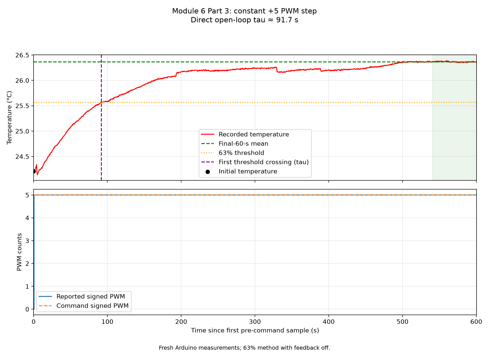

# Module 6 Part 3 — Thermal time constant

**Directly measured open-loop time constant: τ ≈ 91.7 seconds.**

This is a fresh constant-PWM open-loop measurement. No P or PI feedback
was active, so the 63% crossing directly estimates τ = C/H.

## Recorded measurements

| Quantity | Value |
|---|---:|
| Initial temperature, Tᵢ | 24.210 °C |
| Approximate final temperature, T𝒇 | 26.366 °C |
| Final averaging window | 60 s |
| Final-window temperature range | 26.35–26.39 °C |
| Constant applied heating command | +5 PWM |
| Median sampling interval | 0.570 s |

The final-window mean approximates the settled temperature; averaging alone
does not establish that the system has settled.

## Calculation

### 1. Find the 63% temperature

T₆₃ = Tᵢ + 0.63 × (T𝒇 − Tᵢ)

T₆₃ = 24.210 + 0.63 × (26.366 − 24.210)

**T₆₃ = 25.568 °C**

### 2. Read the first crossing time

The temperature first reaches the threshold **91.690 s**
after the initial recorded reading. The crossing lies between adjacent
measurements at 91.130 and 91.690 s.

Because PWM is constant and feedback is off, this directly estimates **τ = C/H**.
The exact exponential fraction at one time constant is 1 − exp(−1) ≈ 0.632;
the lab uses the practical approximation 0.63.

### 3. Open-loop result

No feedback correction is required. **τ ≈ 91.69 s.**

## Annotated measurement plot

The orange horizontal line marks T₆₃. The purple vertical line marks the
first crossing. The green shaded region identifies the final averaging
window. The lower panel confirms the constant applied PWM during the step.
All recorded excursions are retained; no temperature points are filtered out.

## Uncertainty and limitations

| Check | Result |
|---|---:|
| Adjacent-sample crossing bracket | 91.13–91.69 s |
| One sampling interval | 0.57 s |

These describe sampling resolution, not a confidence interval or a complete
uncertainty budget. Command timing within a sample, temperature measurement uncertainty,
thermal lag, ambient drift, and departures from a single exponential can add
systematic error. This constant-PWM run avoids a P-feedback correction. The inferred τ determines C/H; it does not determine
C and H separately.

### Sensitivity to the final averaging window

| Final window (s) | Final mean (°C) | 63% threshold (°C) | Measured τ (s), first sample | Interpolated τ (s) |
|---:|---:|---:|---:|---:|
| 30 | 26.3611 | 25.5652 | 91.69 | 91.42 |
| 60 | 26.3659 | 25.5682 | 91.69 | 91.59 |
| 90 | 26.3656 | 25.5680 | 91.69 | 91.58 |

The primary result uses the first sampled crossing, as specified in the lab.
Different thresholds can cross at exactly the same recorded sample. The last
column interpolates between the two bracketing readings to show smaller
differences; it assumes a locally linear rise and adds no measurement precision.

## Data and reproducibility

Source recording: [open_loop_step_20261013_113417_759949.csv](data/open_loop_step_20261013_113417_759949.csv)

- [Annotated PNG](results/open_loop_step_20261013_113417_759949_kp_0_63_percent.png)
- [Worked analysis and independent cross-check](README.md)

Re-run `estimate_tau.py` to reproduce the calculation. Use `--export-data`
only if you need an additional JSON calculation or selected-trace CSV.

The matching Module 5 Arduino sketch averages 1,000 raw ADC readings before
temperature conversion. The CSV itself does not record the firmware version
or averaging count; confirm that the matching sketch was used for this run.
