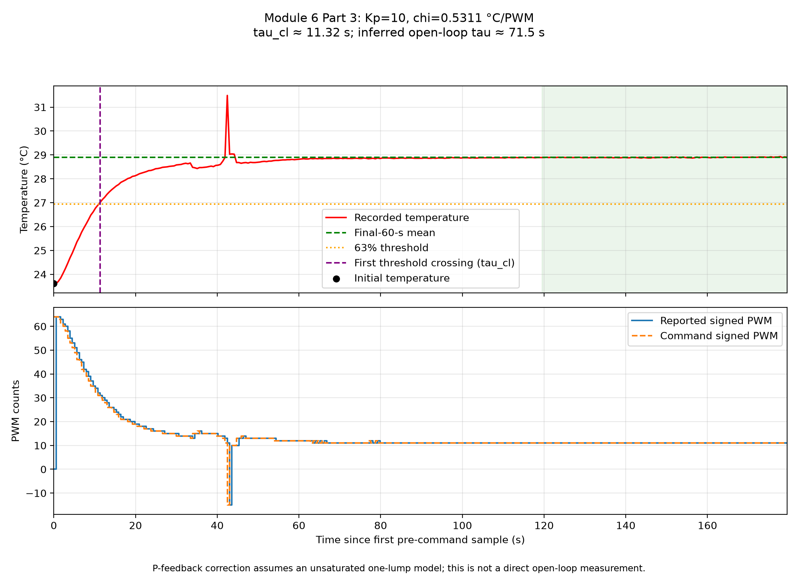
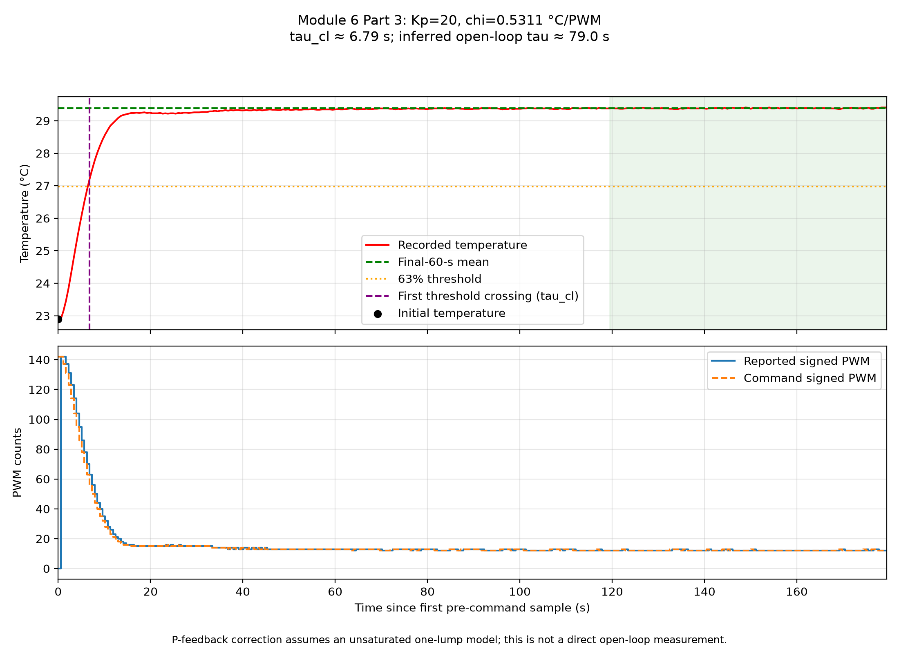

# Module 6, Part 3 — Estimate the thermal time constant

Open [PART3_RESULTS.md](PART3_RESULTS.md) for the formatted output.
The `results/` folder contains the fresh measurement plot and historical comparison plots.

The fresh supervised October 13 measurement used constant **+5 PWM** after
a stable zero-output baseline. It gives **τ ≈ 91.7 s**, from an initial
24.210 °C, final-60-s mean 26.366 °C and threshold 25.568 °C. The last minute
spanned 26.35–26.39 °C. Both outputs were confirmed zero after the run.
This direct result supersedes the earlier P-corrected estimate for the current
apparatus conditions; see `PART3_RESULTS.md` for the calculation and plot.

## Fresh direct Arduino measurement

`record_tau_step.py` uses the existing Module 5 firmware and its 1,000-reading
averaging. Close Serial Monitor and other controllers first. With the
instructor-cleared setup supervised, run:

```sh
python PHYS39A_instrumentation/code/module6/Part1/P3_estimate_tau/record_tau_step.py --port /dev/cu.usbmodem101
```

It first holds PWM=0 until the final 60 seconds vary by at most 0.15 °C
and their half-window means differ by at most 0.05 °C. It then holds
constant +5 PWM within a **five-minute total budget**, including the baseline,
shutdown and report generation. The baseline waits at most 120 seconds;
the remaining acquisition time is used for the step. It retains all raw baseline/step readings
in timestamped files under `data/`, checks the final-window stability,
confirms zero output, and updates `PART3_RESULTS.md` with a direct 63%
estimate. No Kp correction is used for this open-loop measurement.
If the endpoint is not stable, the recording is preserved but the report
is not replaced. Ctrl-C requests shutdown. The trial bounds are 15–35 °C;
the Arduino's independent shutdown and command watchdog remain active.
Raw data files do not embed the averaging count; use the matching firmware.

For a later recalculation, pass its CSV to `estimate_tau.py --input PATH --kp 0`.
The historical P-feedback analysis below is retained as a comparison.

Assignment: [Module 6, Part I](https://sethfraden.github.io/Phys39F26-course/labs/lab-06/#part-3-estimate-tau).
The website's Part 3 asks for a temperature-step estimate of tau, the 63%
threshold, and uncertainty, using temperatures averaged from exactly 1,000
raw thermistor-voltage readings. PI implementation is Part 7 on that page.
Earlier PI work was separate from this time-constant analysis.

## Historical comparison using existing P-control data

Primary source: [October 5 Module 5 CSV](../../../module5/P5_high_gain_response/high_gain_20261005_110725.csv),
first run, Kp=10 PWM/°C, fixed setpoint 30 °C. It starts with reported PWM=0
and the first nonzero command is sent after that temperature measurement.
The recording ends at gain elapsed time 180.051 s. Time zero for this
calculation is its first pre-command reading at 0.556 s, rather than USB
connection time. The exact actuator step time lies after that reading and
before the next report; a sample-sized timing uncertainty is appropriate.

The [matching Module 5 sketch](../../../module5/P1_P-only_control/P1_arduino_control/P1_arduino_control.ino)
sets `TEMPERATURE_SAMPLES = 1000`, averages ADC readings first, and converts
that average to temperature. This supports the required acquisition method
if that matching sketch was uploaded for the recording. The CSV itself does
not store the averaging count or firmware hash, so it cannot independently
prove which firmware was running. The current Module 4 sketch uses 500
samples and was excluded from the primary calculation.

Using the first measured temperature and the mean over the final 60 seconds:

| Quantity | Value |
|---|---:|
| Initial temperature | 23.610 °C |
| Approximate final temperature | 28.893 °C |
| Final-window temperature range | 28.87–28.93 °C |
| Median sample interval | 0.566 s |
| 63% threshold | 26.938 °C |
| First crossing, relative to initial reading | 11.325 s |
| Crossing bracket between adjacent samples | 10.760–11.325 s |

$$
T_{63}=T_i+0.63(T_f-T_i)
=23.610+0.63(28.893-23.610)
=26.938\ ^\circ\mathrm C.
$$

**Because this trace uses P feedback, 11.325 s estimates tau_cl, not the
open-loop tau=C/H.** Under the unsaturated one-lump model,

$$
\tau_{\mathrm{cl}}=\frac{\tau}{1+\chi_h K_p},
\qquad
\tau=(1+\chi_h K_p)\tau_{\mathrm{cl}}.
$$

Using the Module 4 heating susceptibility 0.5311 °C/PWM from the existing
[droop calculation](../../../module5/P4_predict_droop/droop_predictions.csv),

$$
\tau\approx[1+(0.5311)(10)](11.325)
=71.47\ \mathrm{s}.
$$

This is an inferred open-loop estimate, conditional on the one-lump model
and the applicability of that measured susceptibility to this run. The
recorded PWM remains below saturation. The annotated plot shows that PWM
changes during the transient, so it should not be mistaken for a constant-
PWM open-loop step.

The primary recording also contains a sharp temperature excursion near 43 s,
with a short cooling command. This occurs after the 63% crossing and before
the final averaging window. It is retained in the figure, not filtered out.
Its cause is unverified; it is another reason to treat the whole recording
as an approximate/model-dependent estimate rather than a perfect exponential.



## Uncertainty and cross-check

The adjacent-sample crossing bracket maps to **67.91–71.47 s** after the
feedback correction. One sample corresponds to about **3.57 s** in inferred
tau. This is a sampling scale, not a statistical confidence interval.
Changing the final averaging window to 30, 60 or 90 seconds leaves the first
crossing sample unchanged; the final means vary from 28.888 to 28.898 °C.
The final-window range and 0.01 °C CSV reporting precision also limit accuracy.
The 63% approximation differs slightly from the exact fraction 1−exp(−1).

As a check, the [October 7 Kp=20 run](../../../module5/P5_high_gain_response/high_gain_retest_20261007_101645_660586.csv)
gives:

| Quantity | Value |
|---|---:|
| Initial temperature | 22.890 °C |
| Final-60-s mean | 29.386 °C |
| 63% threshold | 26.982 °C |
| Closed-loop first-crossing time | 6.794 s |
| Feedback-corrected tau | 78.96 s |
| Sampling bracket after correction | 72.35–78.96 s |



The two inferred values differ by about 7.5 s (10.5% of the primary estimate).
For the historical P-corrected comparison, report **tau approximately 70–80 s**,
with 71 s as the primary numerical estimate and uncertainty on the order of
several seconds to roughly 10 s. This range is descriptive; it is not a
rigorous error bar and does not bound all systematic effects. Uncertainty in
chi, differences in initial thermal states, sensor/transport lag, ambient
conditions and departures from a one-lump exponential are not independently
quantified here. A direct unsaturated constant-PWM step with 1,000-reading
averaging would provide a stronger estimate if one is required.

The long disabled interval in the Module 5 GUI recording was also considered
as a zero-PWM cooling candidate. Temperature falls and then rises again during
that interval, making its final value unsuitable as a single passive
exponential asymptote. It was not used to infer tau.

**Physical interpretation:** this estimate determines C/H, in seconds. It
does not separately determine the capacitance C or heat-loss conductance H.
Do not enter the uncorrected 11.3 s crossing time as the open-loop tau in the
prepared simulation.

## Reproduce

From the PHYS 39a workspace, in the phys39a environment:

```sh
python PHYS39A_instrumentation/code/module6/Part1/P3_estimate_tau/estimate_tau.py
```

For the independent check:

```sh
python PHYS39A_instrumentation/code/module6/Part1/P3_estimate_tau/estimate_tau.py --input PHYS39A_instrumentation/code/module5/P5_high_gain_response/high_gain_retest_20261007_101645_660586.csv --kp 20
```

By default the analysis uses the latest fresh step recording, falling back
to the historical gain-10 trace only if no fresh recording exists. Pass an
explicit `--input` to select historical data. Each command updates
`PART3_RESULTS.md` directly in this folder and saves
an annotated PNG in `results/`. Running the cross-check command replaces
the report with that run's calculation; run the default command afterward
to restore the primary result. Additional CSV/JSON exports are available
with `--export-data`. Source measurements are retained unchanged. No Arduino
connection or actuator power is needed.
