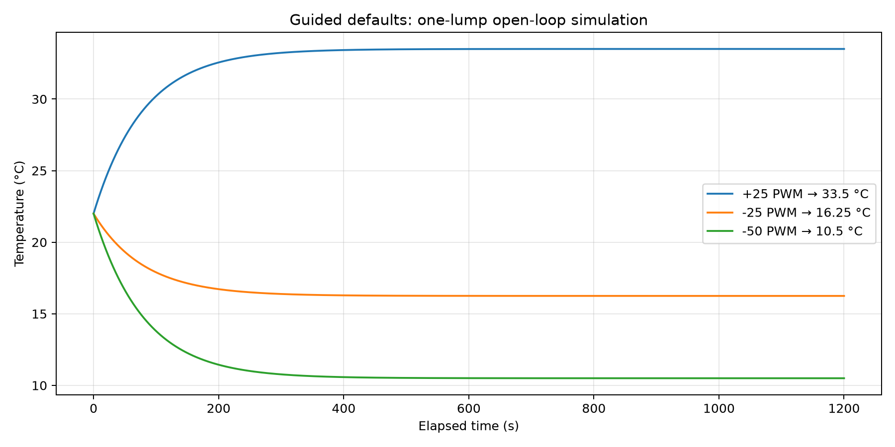
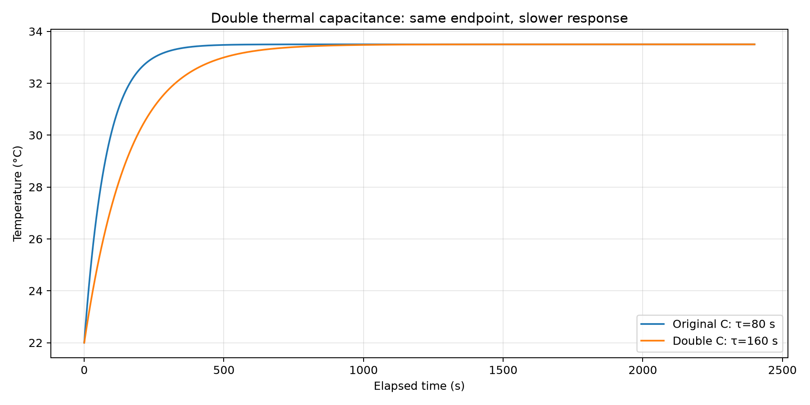
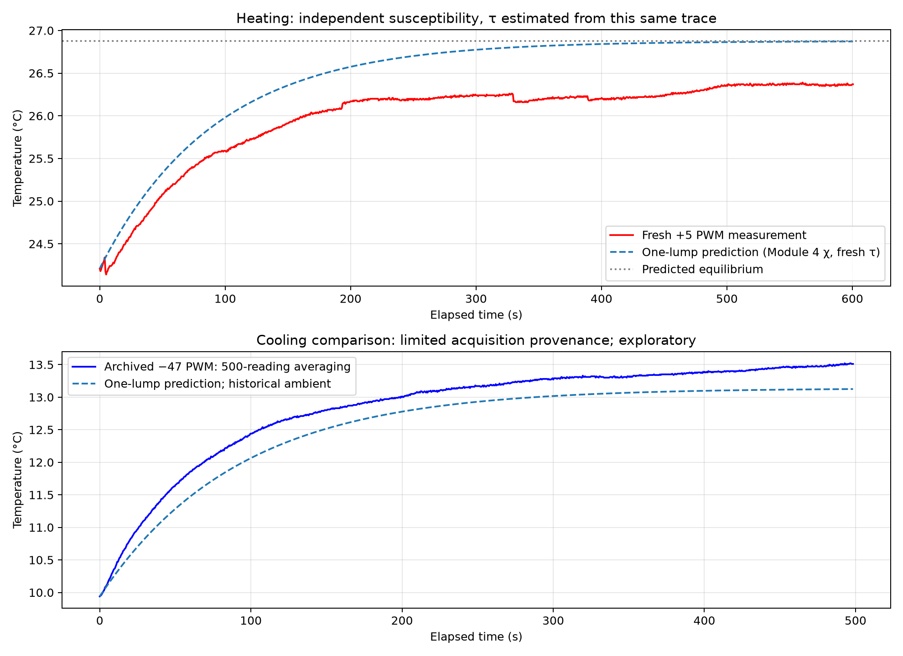
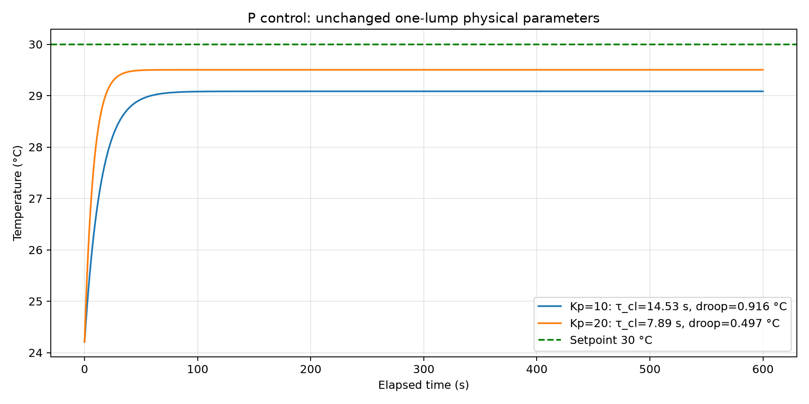

# Module 6 Part 4 — One-lump open-loop and P simulations

**Completed the numerical guided exercises using the provided simulation's
`simulate()` and `advance_model()` functions. No Arduino power is used.**

## 1. Equations and implementation

The prepared model advances temperature with forward Euler:

$$T_{n+1}=T_n+\frac{\Delta t}{C}[P_u u-H(T_n-T_{amb})]
=T_n+\frac{\Delta t}{\tau}(T_{amb}+\chi u-T_n).$$

`advance_model()` computes applied TEC power, subtracts passive heat loss,
divides by C, then multiplies by dt. `active_tec_coefficient()` chooses the
heating or cooling coefficient according to signed u. This analysis imports
that implementation rather than replacing its physics.

## 2. Required default open-loop cases

Settings: one_lump, measured, open_loop; ambient/initial 22 °C,
χ_h=0.46 °C/PWM, χ_c=0.23 °C/PWM, τ=80 s, dt=0.05 s, PWM limit ±255.
Predictions use **T_ss=T_amb+χu** before numerical integration.

| Signed PWM | Predicted equilibrium (°C) | Simulated at 1200 s (°C) | Recovered χ (°C/PWM) |
|---:|---:|---:|---:|
| +25 | 33.500 | 33.500 | 0.46000 |
| -25 | 16.250 | 16.250 | 0.23000 |
| -50 | 10.500 | 10.500 | 0.23000 |

The recovered slopes agree with χ_h=0.46 and χ_c=0.23, giving r=2.
Equal positive/negative PWM produce unequal excursions because reversible
Peltier transport changes sign while Joule heating contributes in both
directions: it aids heating and offsets cooling. The maximum Euler departure
from the exact open-loop exponential is 0.0013 °C.



## 3. Double thermal capacitance only

Hold +25 PWM and keep H, P_u,c and r fixed. The default measured-parameter
inversion gives C=130.946 J/°C. Switch to direct
constants and double C to 261.893 J/°C.

**Prediction and numerical result:** equilibrium stays at 33.5 °C, while
τ=C/H doubles from 80 to 160 s. More heat capacity requires more energy to
change temperature; it does not change the final zero-storage heat balance.
Return to measured parameters for the following comparisons.



## 4. Measured-parameter simulation settings

| Parameter | Value and source |
|---|---|
| χ_h | 0.5311 °C/PWM; Module 4 heating fit |
| χ_c | 0.1878 °C/PWM; Module 4 cooling fit |
| Ratio r | 2.8280 |
| τ | 91.69 s; fresh Part 3 63% measurement |
| Heating ambient | 24.220 °C; late zero-PWM baseline mean |
| Heating initial temperature | 24.210 °C |
| Heating command | +5 PWM; matches the fresh measurement |
| Cooling ambient | 21.965 °C; Module 4 zero-PWM range midpoint |
| Cooling initial temperature | 9.940 °C; first recorded sample |
| Cooling command | −47 PWM; matches the archived segment |
| dt | 0.05 s; checked again at 0.025 s |
| TEC module resistance | 1.50 Ω; supplied Laird datasheet |
| PWM clamp | ±255 counts |

**ON-state voltage has not been supplied.** The 12 V program default is provisional, not a measurement. The temperature predictions remain defined by measured χ and τ; absolute C, H and P_u values require the actual voltage.

Temperature dynamics use P_u/H=χ and C/H=τ. At fixed χ and τ, changing the
voltage used in the inversion rescales dimensional constants together and
does not change these one-lump temperature trajectories. It does affect
the inferred physical power and capacitance.

## 5. Experiment versus model

**Fresh heating:** predicted T_ss=26.875 °C; recorded
final-60-s mean=26.366 °C, so the prediction is
+0.510 °C relative to the measurement. Full-trace
RMSE is 0.498 °C. The same heating trace supplied τ, so transient
agreement is not an independent validation. The susceptibility comes from
the earlier Module 4 measurement and has not been refitted here.

**Archived cooling:** predicted T_ss=13.138 °C; final-60-s
mean=13.472 °C. This segment runs from Arduino time
2857.85 to 3356.2 s. Although u is negative,
temperature rises because the initial block is colder than the equilibrium
for −47 PWM after a stronger cooling command. Command direction alone does
not determine the sign of dT/dt.

**Cooling evidence limitation:** the current Module 4 sketch averages 500 raw
readings. This archived trace is an exploratory comparison, not a verified
1,000-reading measurement. A qualifying cooling trace is still needed if
the instructor requires that acquisition rule for the Part 4 comparison.
The newly measured τ is also being carried across dates and directions as
a one-lump approximation. No fresh cooling run was performed here.

The model assumes one uniform thermal temperature, fixed ambient and constant
susceptibility. The fresh recording shows local deviations and a lower final
heating temperature; heat transport, changing ambient/contact conditions and
direction/temperature dependence of effective TEC power can explain departures.
These data do not independently identify which mechanism dominates.



## 6. Numerical time-step check

dt/τ=0.000545. Halving dt from 0.05 to 0.025 s changes the fresh
heating prediction by at most **0.000134 °C** at common sample times.
That is below the recorded 0.01 °C reporting increment. Numerical integration
error is small compared with the experiment/model disagreement.

## 7. Continue with P control

Keep the measured physical parameters, initial temperature and 30 °C target;
use Kp=10 from Module 5 and the larger Kp=20. Predictions are

$$\mathrm{droop}=\frac{T_{set}-T_{amb}}{1+\chi_hK_p},
\qquad \tau_{cl}=\frac{\tau}{1+\chi_hK_p}.$$

- **Kp=10, Ki=0:** predicted droop 0.916 °C, τ_cl=14.53 s and T_ss=29.084 °C. Euler endpoint agrees within 0.00001 °C; maximum transient difference from the analytic exponential is 0.0031 °C.
- **Kp=20, Ki=0:** predicted droop 0.497 °C, τ_cl=7.89 s and T_ss=29.503 °C. Euler endpoint agrees within 0.00001 °C; maximum transient difference from the analytic exponential is 0.0062 °C.

Increasing Kp reduces both droop and response time. These simulated traces
are monotonic and remain unsaturated; they do not reproduce high-gain
experimental ringing. Settings and agreement are recorded here without
creating another P-control data table.



## Files and how to reproduce

- [Prepared interactive simulation](Lab_6_7_modeling_tec.py)
- [Analysis runner](run_part4.py)
- [Fresh heating CSV](../P3_estimate_tau/data/open_loop_step_20261013_113417_759949.csv)
- [Module 4 susceptibility results](../../../../docs/other_files/module4/P4_Temperature_susceptibility/susceptibility_results.md)
- [Archived cooling CSV](../../../module4/P1_Shutdown_Control/tec_safety_data.csv)

From the PHYS 39a workspace:

```sh
python PHYS39A_instrumentation/code/module6/Part1/P4_Simulate_open_loop_control/run_part4.py
```

Supply `--voltage YOUR_MEASURED_VALUE` to replace the provisional voltage.
For the interactive prepared GUI, run the same path with
`Lab_6_7_modeling_tec.py` instead of `run_part4.py`; select one_lump and measured
and enter the values above. The GUI still starts with its original defaults.
All curves in this report are explicitly simulations or labeled recordings.
