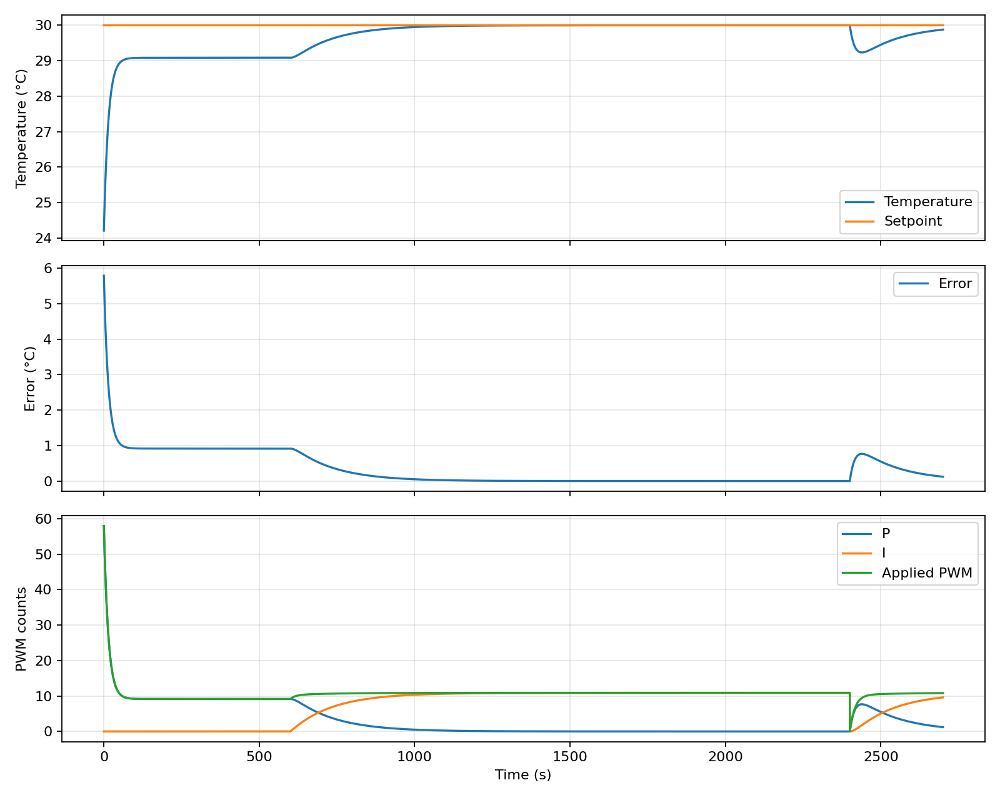
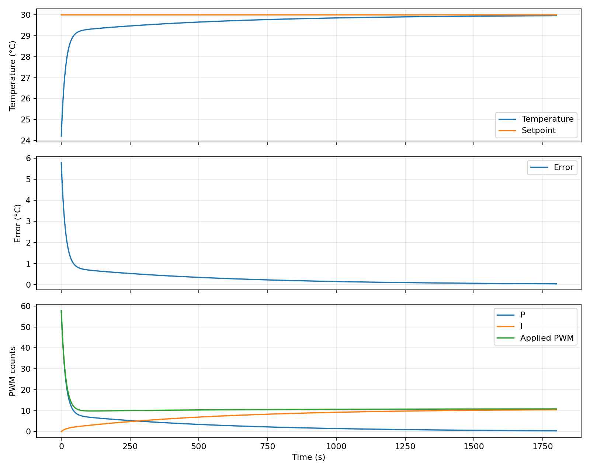
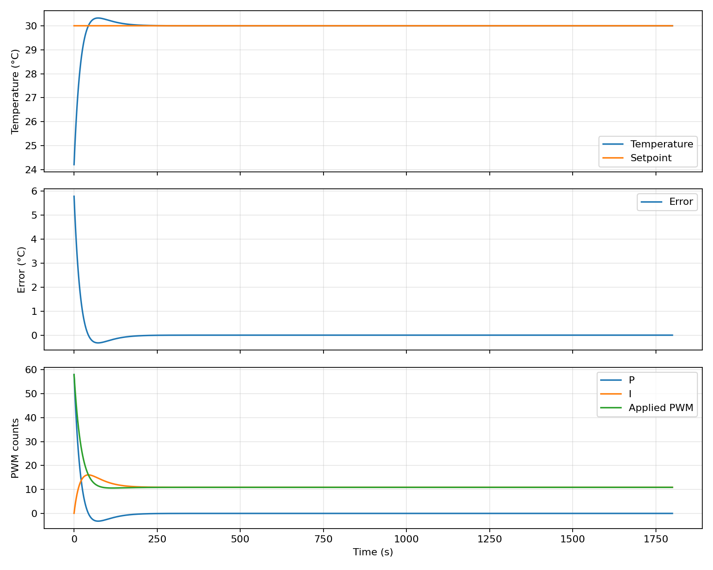
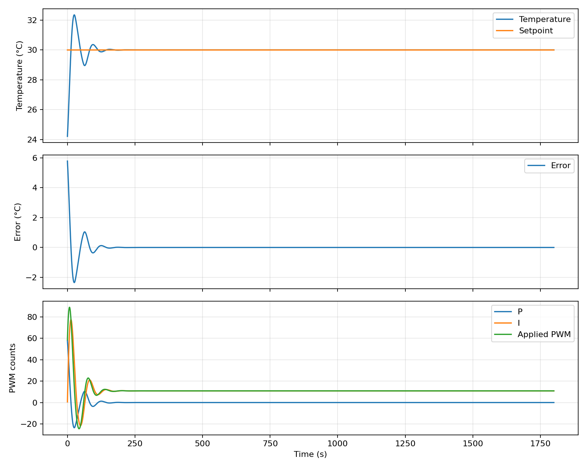
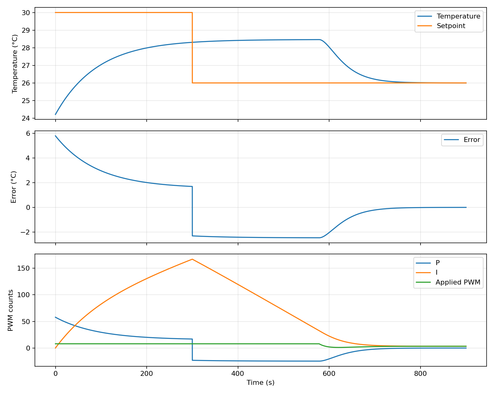
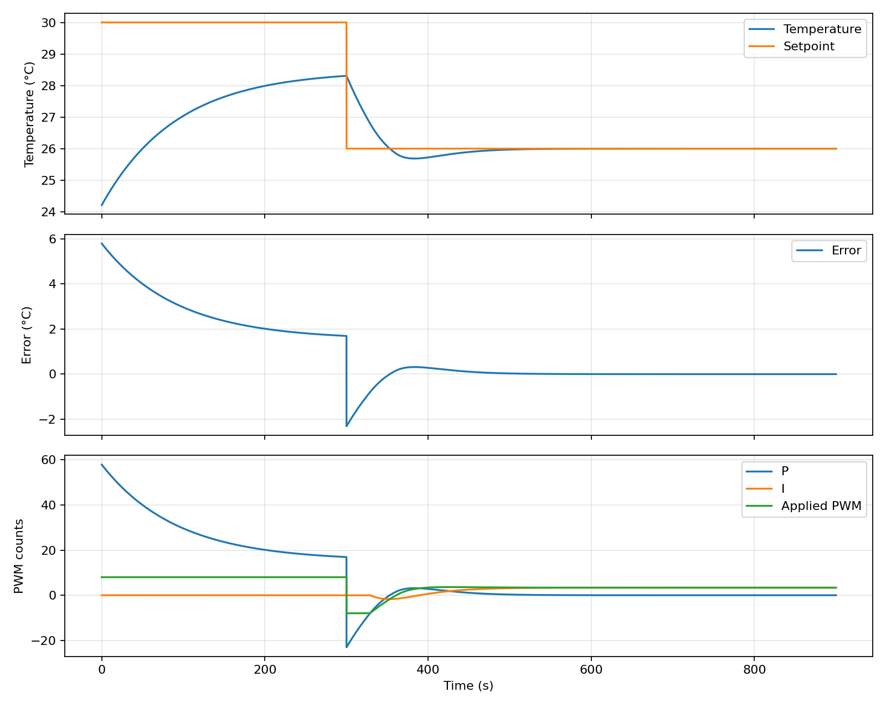

# Part 6 — Integral action in simulation

Settings: one lump, 12 V, χ_h = 0.5311 °C/PWM, χ_c = 0.1878 °C/PWM,
τ = 91.69 s, Δt = 0.05 s, ambient 24.220 °C, target 30 °C,
Kp = 10 PWM/°C, Ki = 0.08 PWM/(°C·s), PWM limit ±255, anti-windup on.

Start with P control, let it settle, then switch to PI with q = 0.
P settles at **29.084 °C**; PI reaches **30.000 °C**.

## Guided answers

1. **Why does u_I grow while e > 0?** Each step adds eΔt to the stored error q. Since u_I = Ki q, the integral contribution grows.
2. **Why does u_P approach zero at the target?** u_P = Kp e, and the error approaches zero.
3. **Why can u_I remain nonzero when e = 0?** Zero error stops adding to q; it does not erase q. Here u_I remains about **10.883 PWM**, supplying the heat lost to the room.
4. **Why does resetting the integral move temperature away from the target?** Resetting q removes that heating command. The block initially cools; the controller then rebuilds the required output.

## Changing Ki

Keep Kp = 10 and reset q before each run.

- Ki = 0.02 PWM/(°C·s): damping ratio ζ = 3.197.
- Ki = 0.2 PWM/(°C·s): damping ratio ζ = 1.011.
- Ki = 2 PWM/(°C·s): damping ratio ζ = 0.320.

Larger Ki corrects the stored error more strongly and lowers damping. The high-Ki
case overshoots and rings, but the oscillations decay. Underdamped does not mean unstable.

## Windup and anti-windup

For this demonstration only, limit PWM to ±8, use Ki = 0.2, and lower the target
from 30 to 26 °C at 300 s. The 30 °C target requires more than 8 PWM.

Without anti-windup, q keeps growing while PWM is capped. The stored error delays
recovery after the target drops. With anti-windup, q is held when adding error
would push the request farther beyond the limit. Error that brings it back is allowed.
The PWM clamp limits output; anti-windup limits stored error; reset clears stored error.

Add `--save-csv` to export simulation time series if needed.
Reproduce with `python3 run_part6.py` from this directory.
