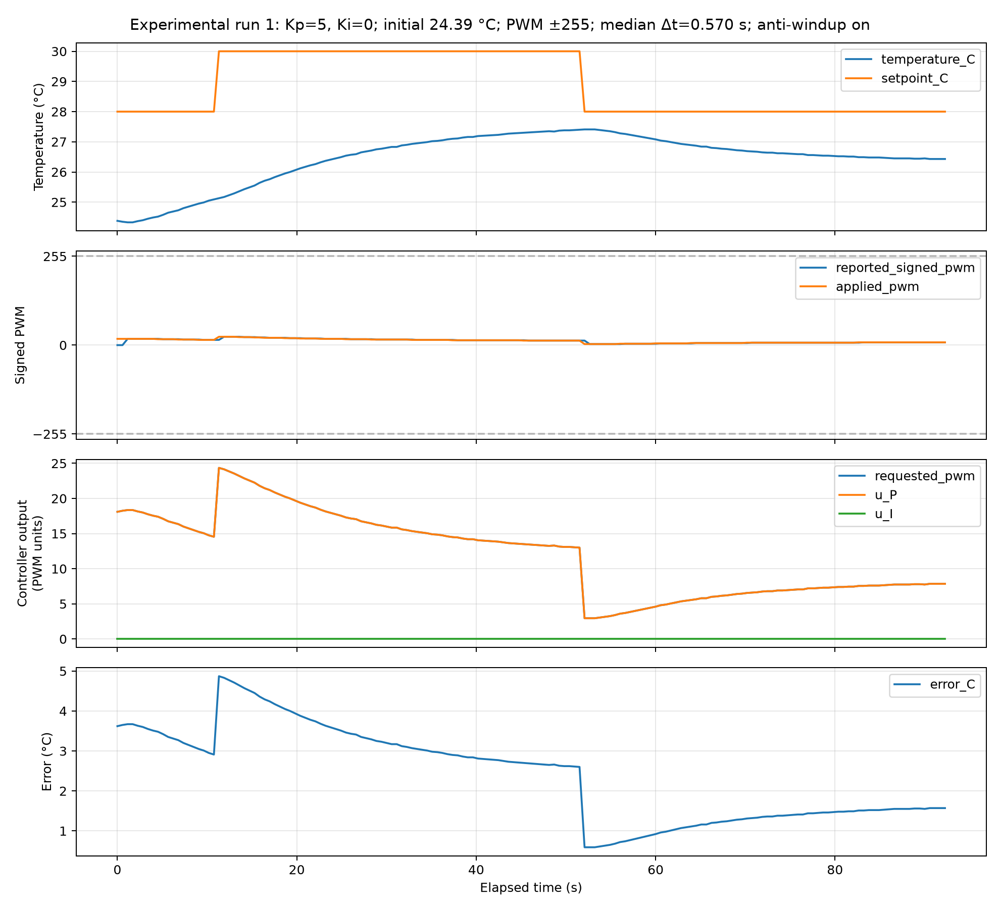
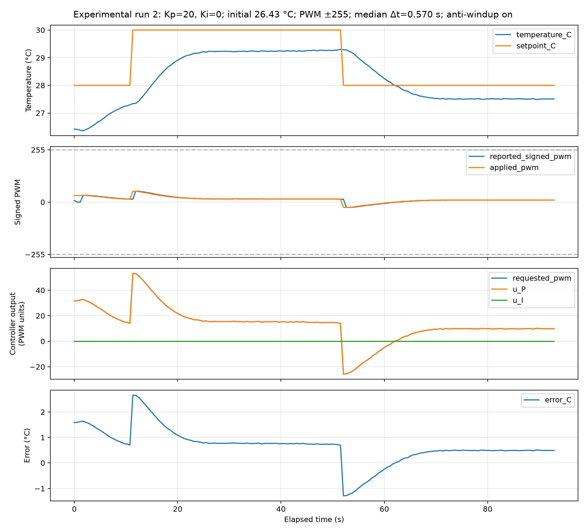
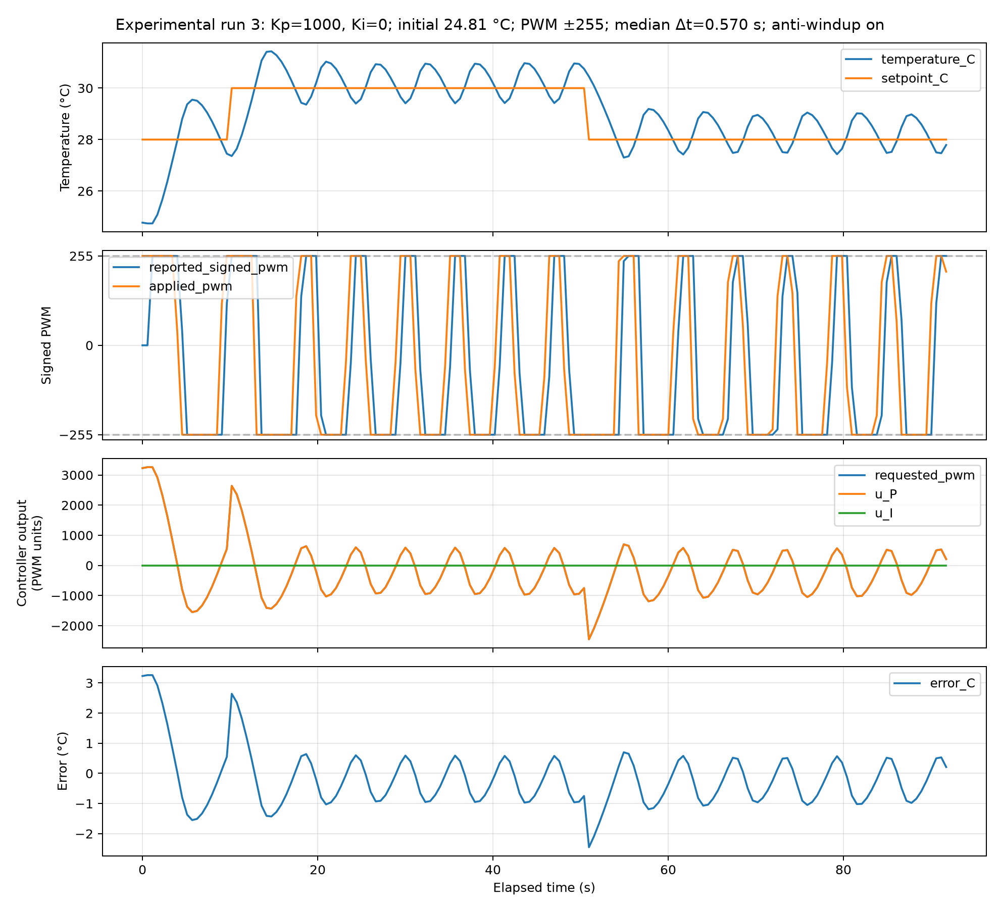
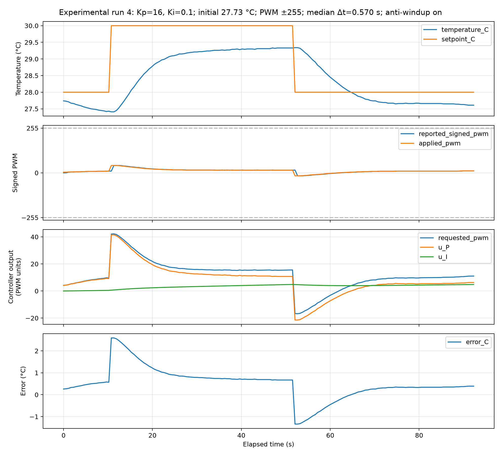
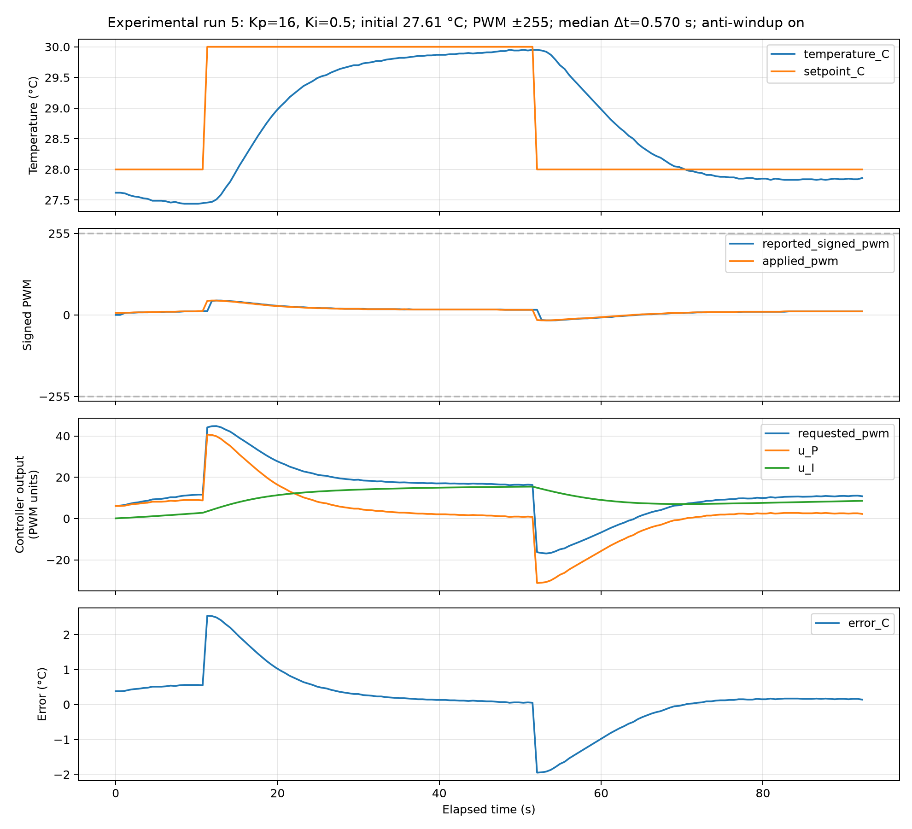
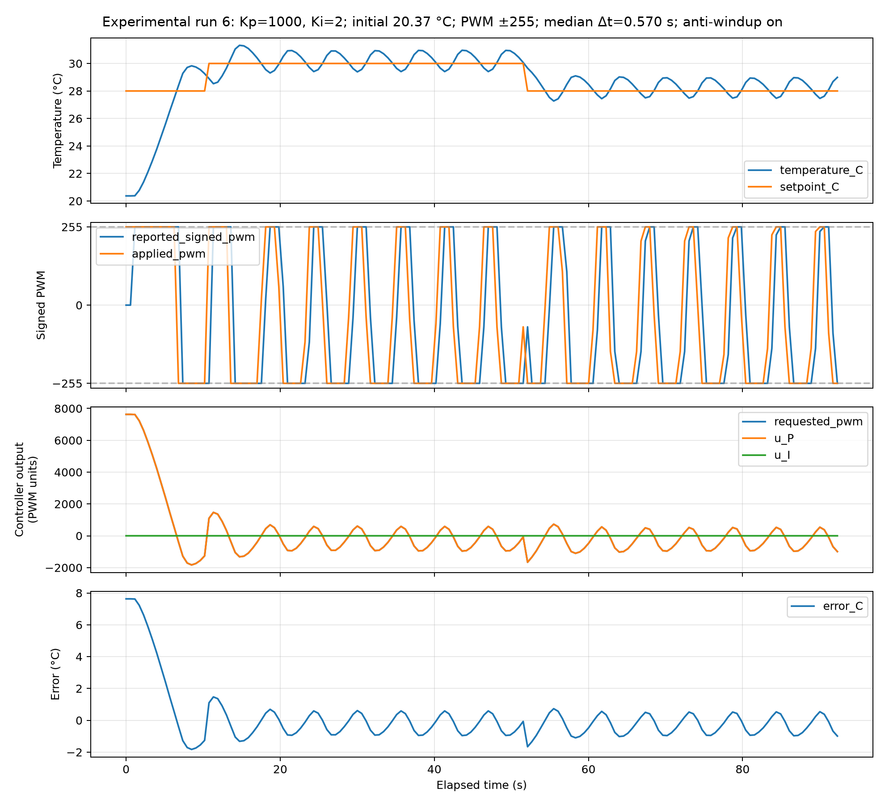

# Part 7 — PI control and Goldilocks results

## Controller

Error e = setpoint − temperature; q_new = q + eΔt;
requested PWM = Kp e + Ki q. Δt uses actual measurement times.
Anti-windup holds q if adding error pushes the request farther beyond ±255.
Applied PWM is clamped and rounded. The Arduino shutdown and timeout remain active.

q was reset before each run, with PWM zero first. It was not reset between steps.
Temperature, error, P, I, requested PWM, and applied PWM were recorded.

## Settings

Same apparatus, **28 → 30 → 28 °C**, **PWM limit ±255**, anti-windup on.
Sample interval: **≈0.57 s**. Each run: **10 s baseline + 40 s upward + 40 s downward**.
End temperatures below average each step's final 5 s; **full settling is unconfirmed**.

| Run | Mode | Kp | Ki | End at 30 °C target | End at 28 °C target |
|---|---|---:|---:|---:|---:|
| 1 | P | 5 | 0 | 27.36 °C | 26.44 °C |
| 2 | P | 20 | 0 | 29.27 °C | 27.51 °C |
| 3 | P | 1000 | 0 | 30.24 °C | 28.25 °C |
| 4 | PI | 16 | 0.1 | 29.33 °C | 27.63 °C |
| 5 | PI | 16 | 0.5 | 29.94 °C | 27.84 °C |
| 6 | PI | 1000 | 2 | 30.32 °C | 28.22 °C |

Kp: PWM/°C. Ki: PWM/(°C·s).

Run 3 was repeated on **October 19, 2026** at **Kp = 1000, Ki = 0**; Run 6 was also repeated on October 19 at **Kp = 1000, Ki = 2**. Runs 1, 2, 4, and 5 retain their October 14 measurements. The numeric gain has no physical maximum; 1000 is the selected high-gain setting, while the actuator remains limited to ±255 PWM. Baseline and step transitions follow host timers, so measured stages can be about 1 s longer than nominal. Starting conditions differ, and the 10 s baseline does not establish equilibrium.

Selected Run 3: [Kp = 1000 recording](data/screening_run3_20261019_093931_013605.csv). Earlier Run 3 recordings at [Kp = 200](data/screening_run3_20261019_093717_561506.csv) and [Kp = 40](data/screening_run3_20261014_105335_877556.csv) are preserved. The Kp = 200 trial peaked at 30.91 °C and reached 27.43 °C on the downward step; 22/164 commands saturated.

Selected Run 6: [Kp = 1000, Ki = 2 recording](data/screening_run6_20261019_094847_056154.csv); the [original Kp = 16, Ki = 2 recording](data/screening_run6_20261014_105814_945122.csv) is preserved.

## Answers

- **Increasing Kp:** intermediate gain reduced the P error; the new **Kp = 1000** Run 3 showed repeated oscillations about the targets, with **1.43 °C upward overshoot** (peak **31.43 °C**) and **0.70 °C downward undershoot** (minimum **27.30 °C**). Frequent output clipping makes this a nonlinear high-gain response; these short runs do not establish long-term stability.
- **Increasing Ki:** Runs 4 and 5 retain Kp = 16, with faster integral correction at Ki = 0.5. Run 5 remains the best observed compromise among the original matched-Kp PI trials. The original Run 6 (Kp = 16, Ki = 2) overshot by **0.76 °C** upward and undershot by **0.86 °C** downward. The selected rerun changes Kp to **1000**, so its response cannot be attributed to Ki alone: it shows oscillations with **1.32 °C upward overshoot** (peak **31.32 °C**) and **0.73 °C downward undershoot** (minimum **27.27 °C**).
- **Integral contribution:** in Run 5's upward step, I grew from **3.52 to 15.46 PWM**. Final recorded error was **0.05 °C**, versus **0.70 °C** for Run 2. These are end-of-step errors, not verified steady-state errors.
- **Saturation:** the new Run 3 reached **±255 PWM**, with **133/163 recorded commands** at the limit. At Kp = 1000, errors of at least **0.255 °C** saturate the output. Run 6 also reached **±255 PWM**, with **132/164 recorded commands** at the limit. Runs 1, 2, 4, and 5 remain below saturation (maximum absolute PWM **53**).

Starting temperatures differed and were recorded:

| Run | Upward-step start (°C) | Downward-step start (°C) |
|---|---:|---:|
| 1 | 25.13 | 27.41 |
| 2 | 27.34 | 29.29 |
| 3 | 27.36 | 30.45 |
| 4 | 27.41 | 29.34 |
| 5 | 27.46 | 29.95 |
| 6 | 28.90 | 29.66 |

## Figures

Each figure shows measured temperature and setpoint, applied and reported signed PWM (limited to ±255), unclamped controller output and P/I contributions in a separate panel (PWM units), and error. The controller calculations may exceed ±255; they are not the applied PWM.

**Run 1 — Low-gain P, Kp = 5, Ki = 0**

**Run 2 — Intermediate-gain P, Kp = 20, Ki = 0**

**Run 3 — High-gain P, Kp = 1000, Ki = 0**

**Run 4 — Low-Ki PI, Kp = 16, Ki = 0.1**

**Run 5 — Intermediate-Ki PI, Kp = 16, Ki = 0.5**

**Run 6 — High-gain PI, Kp = 1000, Ki = 2**

[Raw recordings](data/) · [Controller](pi_logic.py) · [GUI](pi_control_gui.py) · [Plotter](plot_goldilocks.py) (use `--allow-mixed-pi-kp` for the selected runs)
