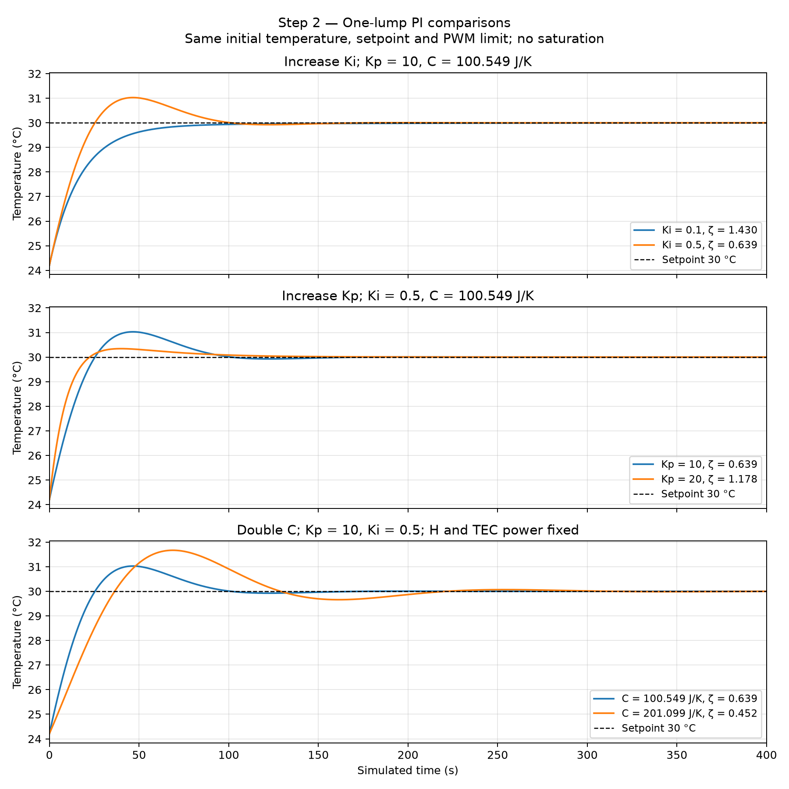
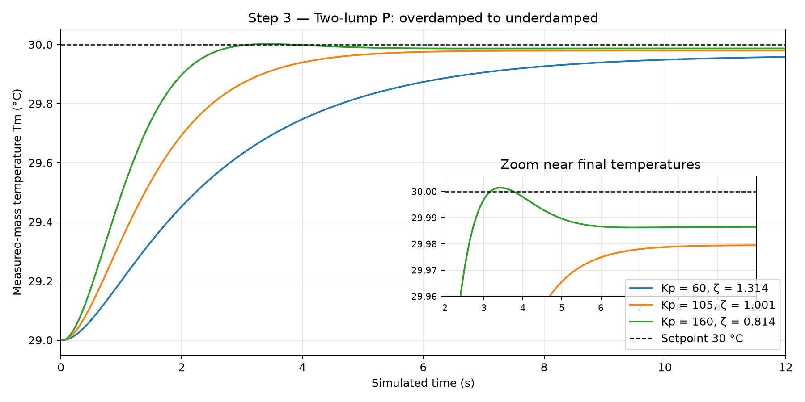
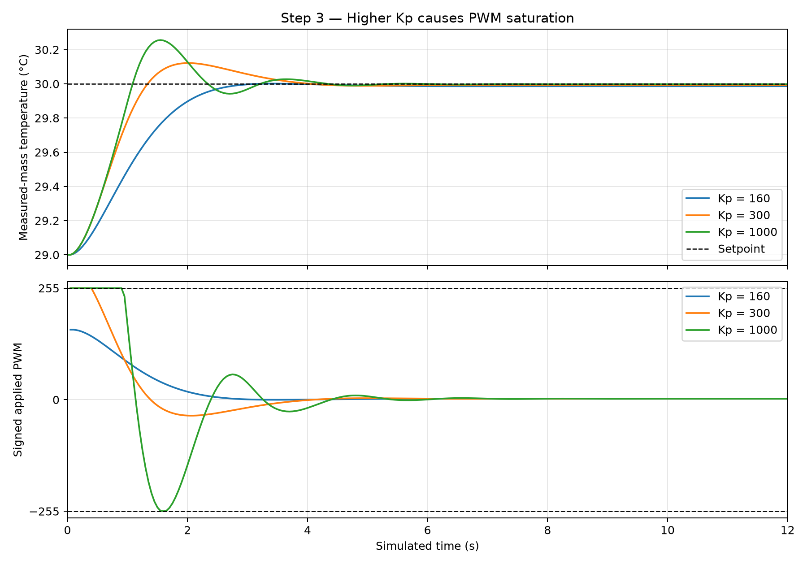
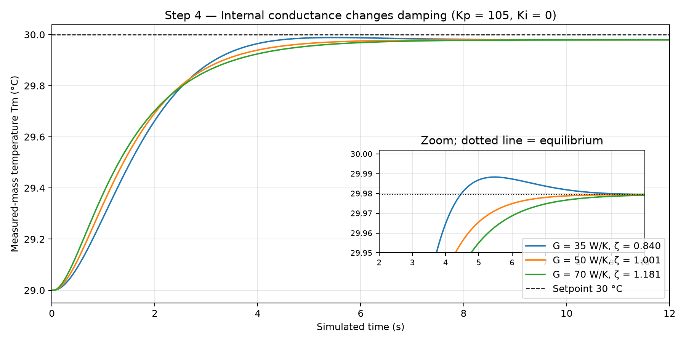
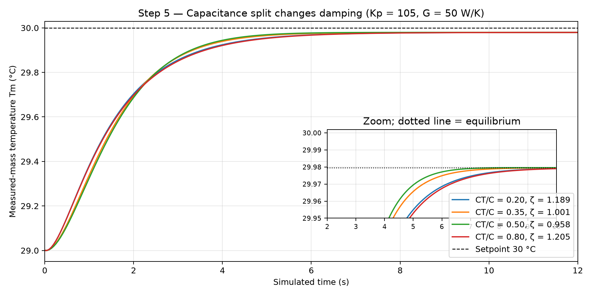

# Part II — Results

## Step 1: Check the original one-lump model

**Passed.** The model matches our saved Part I baseline. No new simulation run was needed.

Run from `Part_II` to open the model with our settings:

```sh
/opt/anaconda3/envs/phys39a/bin/python step1/check_baseline.py
```

Check these values in the GUI:

| Item | Expected |
|---|---|
| Model / source / controller | `one_lump` / `measured` / `p` |
| Kp / Ki | 10 / 0 |
| Cooling / heating susceptibility | 0.19 / 0.53 °C/PWM (rounded) |
| Open-loop / controlled time constant | 91.69 / 14.53 s |
| Predicted droop below 30 °C | 0.92 °C |

These agree with the [saved Part I results](../Part_I/P4_Simulate_open_loop_control/PART4_RESULTS.md). The GUI starts paused at time zero.

## Step 2: Explore one-lump PI control

**Complete.** Predictions matched the simulated trends:

| Change (everything else fixed) | Predicted damping ζ | Observed overshoot |
|---|---|---|
| Increase Ki: 0.1 → 0.5, Kp = 10 | Decreases: 1.430 → 0.639 | 0.00 → 1.03 °C; ringing appears |
| Increase Kp: 10 → 20, Ki = 0.5 | Increases: 0.639 → 1.178 | 1.03 → 0.34 °C; repeated ringing suppressed |
| Double C: 100.549 → 201.099 J/K, Kp = 10, Ki = 0.5 | Decreases: 0.639 → 0.452 | 1.03 → 1.67 °C; stronger ringing |

Each run reset temperature and integral, used the same 24.21 → 30 °C step, and ran for 1200 simulated seconds. Direct constants kept H and TEC power fixed when changing C. No PWM saturation occurred. The measured physical parameters remain unchanged.



The figure shows the first 400 s on matching axes. Higher Ki and C increase overshoot and ringing; higher Kp reduces them. This supports the practice comparisons and is separate from the six required Goldilocks plots.

Run from `Part_II` to reproduce:

```sh
/opt/anaconda3/envs/phys39a/bin/python step2/compare_one_lump_pi.py
```

## Step 3: Predict the two-lump P transition

**Complete.** Increasing Kp reduced damping as predicted:

| Kp (Ki = 0) | Damping ζ | Simulated response |
|---|---|---|
| 60 | 1.314 | Overdamped; monotonic approach |
| 105 | 1.001 | Nearly critically damped; monotonic approach |
| 160 | 0.814 | Underdamped; small overshoot followed by decaying ringing |

All runs used the assigned demonstration settings: Tamb = T0 = 29 °C, target 30 °C, C = 91 J/K, CT/C = 0.35, G = 50 W/K, H = 1.14 W/K, Pu,c = 0.26 W/PWM, r = 2, PWM limit 255, and Δt = 0.05 s. Both masses were reset before each run; only Kp changed. No saturation occurred.



Only measured-mass temperature is plotted. The inset makes the small transient visible: Kp = 160 overshoots its final equilibrium by about 0.015 °C. All three responses remain stable. These are practice runs, not the final Goldilocks plots; the measured baseline is unchanged.

### Additional comparison: PWM saturation

Keeping the same 1 °C step and physical settings, higher gains caused clipping:

| Kp | Initial requested PWM | Applied PWM range | Total clipped time over 30 s |
|---|---|---|---|
| 160 | 160 | −0.2 to +160 | 0 s |
| 300 | 300 | −36.5 to +255 | 0.35 s |
| 1000 | 1000 | −255 to +255 | 0.95 s |



Requests beyond ±255 are clipped; **applied PWM never exceeds ±255**. Kp = 300 reaches the heating limit; Kp = 1000 reaches both limits. Saturation makes the response nonlinear, so the linear damping ratio alone no longer describes the full transient. The figure shows the first 12 s; clipped times use the full 30 s simulation.

Run from `Part_II` to reproduce both Step 3 figures:

```sh
/opt/anaconda3/envs/phys39a/bin/python step3/compare_two_lump_p.py
```

## Step 4: Change heat flow between the two masses

**Complete.** With Kp = 105 and Ki = 0, increasing internal conductance G increased damping:

| G (W/K) | Damping ζ | Response |
|---|---|---|
| 35 | ≈0.84 | Underdamped; small overshoot and decaying ringing |
| 50 | ≈1.00 | Nearly critically damped |
| 70 | ≈1.18 | Overdamped; monotonic approach |



G controls how easily heat passes between the TEC-side and measured masses. **Over this range**, stronger coupling reduces ringing. This does not mean decreasing G toward zero always increases ringing. Only G changed from the Step 3 demonstration settings; every run was reset, and none saturated. The measured apparatus settings remain unchanged.

Run from `Part_II`:

```sh
/opt/anaconda3/envs/phys39a/bin/python step4/compare_conductance.py
```

## Step 5: Divide the thermal capacitance between the masses

**Complete.** Total capacitance stayed at 91 J/K, with Kp = 105, Ki = 0, and G = 50 W/K. Only the TEC-side fraction CT/C changed:

| CT/C | Damping ζ | Response |
|---|---|---|
| 0.20 | 1.189 | Overdamped |
| 0.35 | 1.001 | Nearly critically damped |
| 0.50 | 0.958 | Slightly underdamped; very small overshoot |
| 0.80 | 1.205 | Overdamped |



**Damping is weakest near an equal split**, where both masses store appreciable energy. Concentrating capacitance in either mass increases damping. The equal-split overshoot is only about 0.00004 °C above equilibrium in this simulation, so it is not prominent in the figure. Each run reset both temperatures; no saturation occurred, and measured apparatus settings remain unchanged.

Run from `Part_II`:

```sh
/opt/anaconda3/envs/phys39a/bin/python step5/compare_capacitance_split.py
```
