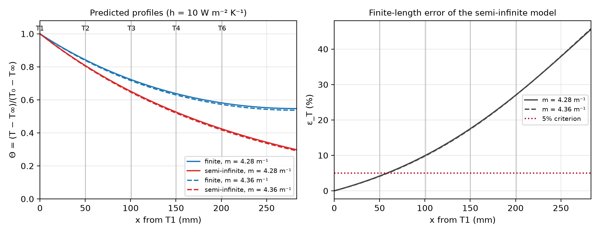

# A4 — Finite Length and Biot Number for the Course Rod

PHYS 39 · Module 7 · **Kyle Chen** (individual) · Assignment A4 · November 2, 2026
Repository: [https://github.com/hasanm720/Module1](https://github.com/hasanm720/Module1) (branch mainv2) · Git commit: **4a9c152cdbb2bc878d431567cdc4e4b2a0cbe184**

Inputs are the measured rod geometry and sensor positions recorded before heating (docs/module_notes/module_07_rod_instrument.md), a literature range for k, and the provisional still-air coefficient h = 10 W m^−2 K^−1. All values below are predictions; A4 does not use the Part III temperature-profile data.

## Part 1 — Apply Fourier's law (Lienhard Problem 1.3)

**Problem.** A slab 1 cm thick carries a steady heat flux q = 5000 W/m² and its cold side is at −40 °C. Find the temperature rise to the hot side for seven materials and identify unreasonable cases.

**Method.** In steady one-dimensional conduction with no heat generation, the flux is the same at every plane, so Fourier's law integrates across the slab with constant k:

$$
q=-k\frac{dT}{dx}\;\Rightarrow\;q=k\frac{\Delta T}{L}\;\Rightarrow\;\Delta T=\frac{qL}{k}
$$

Units: (W m^−2)(m)/(W m^−1 K^−1) = K, so ΔT is in kelvin (equivalently °C for a difference). **Sample calculation (silver):** ΔT = (5000 W/m²)(0.01 m)/(427 W/m·K) = **0.117 K**, matching the textbook check value.

| Material | k (W/m·K) | Source (Lienhard) | ΔT (K) | Hot side (°C) |
| --- | --- | --- | --- | --- |
| Pure silver (99.99+%) | 427 | Table A.1, 20 °C | 0.117 | -39.9 |
| Pure aluminum | 237 | Table A.1, 20 °C | 0.211 | -39.8 |
| Mild steel (0.5% C) | 54 | Table A.1, 20 °C | 0.926 | -39.1 |
| Ice | 2.215 | Table A.2, 0 °C | 22.6 | -17.4 |
| Spruce | 0.11 | Table A.2, 20 °C | 455 | 414.5 |
| Insulation (85% magnesia) | 0.067 | Table A.2, 38 °C | 746 | 706.3 |
| Silica aerogel | 0.024 | Table A.2, 0 °C | 2083 | 2043.3 |

**Physical judgment.** The metals need well under 1 K, and ice warms to about −17 °C, still frozen, so those four cases are reasonable. The last three are not:

• **Spruce:** the hot face would reach about 415 °C, far above the temperature at which wood chars and ignites. The slab could not survive this flux.
• **85% magnesia:** the hot face would reach about 706 °C, beyond the service temperature of this insulation, which is intended for moderate-temperature pipe lagging.
• **Silica aerogel:** a rise of about 2080 K puts the hot face above 2000 °C, past the melting point of silica; the aerogel structure would collapse long before.

These cases also break the calculation's own assumption: k was taken as constant, at one tabulated temperature, but over rises of hundreds of kelvin k changes and the material itself changes. The lesson is the one we apply to our TEC: a large heat flux can only be removed through a good conductor. If the path from a heat source to its sink conducts poorly, the source temperature must climb until it fails, which is why the TEC is protected with a heat sink and an overtemperature shutdown.

## Part 2 — Stationary finite-rod model (Lienhard §4.5)

**Assumptions.** Steady state; constant k and h; uniform cross section A and perimeter P; no internal heat generation; uniform ambient temperature T∞; and a transverse Biot number Bi⊥ = h(A/P)/k ≪ 1, so each cross section has a single temperature T(x) (Lienhard eqn. 4.27; checked in Part 4).

**Energy balance on a slice** of length δx: heat conducted in at x equals heat conducted out at x + δx plus heat convected from the side area Pδx (eqn. 4.28):

$$
-kA\left.\frac{dT}{dx}\right|_{x}=-kA\left.\frac{dT}{dx}\right|_{x+\delta x}+h(P\,\delta x)(T-T_\infty)
$$

Divide by kA δx and let δx → 0. The difference quotient becomes the second derivative, and since T∞ is constant, d²T/dx² = d²(T − T∞)/dx² (eqns. 4.29–4.30). With θ = T − T∞:

$$
\frac{d^2\theta}{dx^2}=m^2\theta,\qquad m^2=\frac{hP}{kA}\quad[\mathrm{m^{-2}}]
$$

Dimension check: hP/(kA) has units (W m^−2 K^−1)(m)/[(W m^−1 K^−1)(m²)] = m^−2, so m is an inverse length and mL is dimensionless. For a round rod, P/A = 4/d, so m² = 4h/(kd).

**Dimensionless form.** With Θ = θ/θ₀ (θ₀ = T₀ − T∞) and ξ = x/L, the equation becomes d²Θ/dξ² = (mL)²Θ (eqn. 4.34), whose general solution is (eqn. 4.35):

$$
\Theta=C_1e^{mL\xi}+C_2e^{-mL\xi}
$$

**Boundary conditions.**
1. **Base, ξ = 0: Θ = 1** (fixed temperature, Dirichlet). Physically the base is held at T₀; for our rod this is the temperature measured by the T1 thermistor at x = 0, not the TEC.
2. **Tip, ξ = 1: dΘ/dξ = 0** (insulated tip, Neumann). No heat crosses the end face, because its area A is small compared with the side area PL and its heat loss is neglected.

Substituting the general solution into both conditions gives C₁ + C₂ = 1 and C₁e^mL − C₂e^−mL = 0 (eqn. 4.37). Solving:

$$
C_1=\frac{e^{-mL}}{2\cosh mL},\qquad C_2=\frac{e^{mL}}{2\cosh mL}
$$

Inserting the constants and using cosh z = (e^z + e^−z)/2 gives the finite, insulated-tip profile (eqn. 4.41), its tip value (eqn. 4.45), and the base heat flow (eqns. 4.42–4.43):

$$
\Theta=\frac{\cosh[mL(1-\xi)]}{\cosh mL}=\frac{\cosh[m(L-x)]}{\cosh mL},\quad\Theta_{tip}=\frac{1}{\cosh mL},\quad Q_0=\sqrt{kAhP}\,\theta_0\tanh mL
$$

## Part 3 — Semi-infinite limit and the provisional finite-length prediction

### Lienhard Problem 4.12: the semi-infinite limit

Use the general solution θ = C₁e^mx + C₂e^−mx (eqn. 4.35, dimensional) with T(0) = T₀ and T(L) = T∞, i.e. θ(0) = θ₀ and θ(L) = 0:

$$
C_1+C_2=\theta_0,\quad C_1e^{mL}+C_2e^{-mL}=0\;\Rightarrow\;\frac{\theta}{\theta_0}=\frac{\sinh[m(L-x)]}{\sinh mL}
$$

For fixed x and L → ∞, sinh[m(L − x)]/sinh(mL) → e^m(L−x)/e^mL, so

$$
\lim_{L\to\infty}\Theta=e^{-mx}\qquad(\mathrm{eqn.\ 4.50})
$$

The insulated-tip profile reaches the same limit, since cosh[m(L − x)]/cosh(mL) → e^−mx when mL ≫ 1. The semi-infinite model keeps the base condition but **loses the tip condition**; the rod is assumed so long that the tip has fallen to T∞. Lienhard recommends mL ≳ 5 for temperatures and mL ≳ 3 for Q₀.

### Example 4.8 and Problem 4.20: the cost of approximating the tip

Example 4.8 (2 cm aluminum rod, 8 cm long, k = 205 W/m·K, h ≈ h_L = 120 W/m²K) has mL = 0.8656 and tip Biot number Bi_ax = h_LL/k = 0.0468. A convecting tip (eqn. 4.48) gives Θ_tip = 0.6890; the insulated-tip approximation gives 0.7150, about 4% high. For the heat flow (Problem 4.20), the insulated tip gives Q₀/(√(kAhP)θ₀) = tanh mL = 0.6991, while eqn. 4.49 gives (Bi_ax/mL + tanh mL)/(1 + (Bi_ax/mL) tanh mL) = 0.7258. The approximation underestimates Q₀ by **3.67%** (book: 3.67%).

For **our rod** with h_L ≈ h = 10 W/m²K, Bi_ax = hL/k ≈ 0.0168 and Bi_ax/mL ≈ 0.014, so the insulated tip predicts Θ_tip = 0.542 compared with 0.536 for a convecting tip, a 1.2% difference. The insulated-tip model is adequate for our rod at this h.

### Provisional prediction for the course rod

**Inputs:** d = 12.705 ± 0.025 mm; L = 283.2 ± 2 mm (T1 hole to tip); sensor positions x = 0.00, 50.30, 100.96, 150.32, 200.95 mm (± 0.5 mm) for T1, T2, T3, T4, T6; h = 10 W/m²K (provisional, still air); k = 166–172 W/m·K (6061-T6, Lienhard Table A.1, 0–100 °C, which spans our 20–45 °C operating range); error criterion ε_T < 5% at every sensor.

$$
m=\sqrt{\frac{4h}{kd}},\qquad \varepsilon_T(x)=\frac{|\Theta_{finite}-\Theta_\infty|}{|\Theta_{finite}|}
$$

**m = 4.28–4.36 m^−1** (decay length 1/m = 23.0–23.4 cm; the ±0.025 mm diameter uncertainty adds only ±0.1% to m). **mL = 1.21–1.23**, far below Lienhard's mL ≳ 5.

| Sensor | x (mm) | Θ finite | Θ semi-infinite | ε_T (%) | ε_T < 5%? |
| --- | --- | --- | --- | --- | --- |
| T1 | 0.00 | 1.000–1.000 | 1.000–1.000 | 0.0–0.0 | yes |
| T2 | 50.30 | 0.838–0.842 | 0.803–0.806 | 4.1–4.2 | yes |
| T3 | 100.96 | 0.715–0.722 | 0.644–0.649 | 9.9–10.1 | no |
| T4 | 150.32 | 0.630–0.638 | 0.520–0.526 | 17.5–17.6 | no |
| T6 | 200.95 | 0.572–0.581 | 0.417–0.423 | 27.1–27.2 | no |
| tip | 283.2 | 0.537–0.547 | 0.291–0.298 | 45.6–45.8 | no |

*Figure 1. Predicted finite (insulated-tip) and semi-infinite profiles for the course rod at the two ends of the k range (left), and the finite-length error ε_T(x) (right). Vertical lines mark the five rod sensors.*

**Conclusion (length):** the course rod is **not** adequately semi-infinite over the measured region. ε_T stays below 5% only at T1 and T2; it reaches about 10% at T3, 17% at T4 and 27% at T6, and the semi-infinite model would put the tip at Θ ≈ 0.29 instead of 0.54 (ε_T ≈ 46%). The stationary data should therefore be fitted with the finite-length model. This conclusion depends on the measured L and sensor positions, the provisional h, the k range, and the 5% criterion. Because mL ∝ √h, a larger true h would make the rod look longer: mL would need to grow by a factor of about 4.1 (h about 17 times larger) to reach mL ≈ 5.

## Part 4 — Provisional one-dimensional (radius) prediction

The transverse Biot number compares conduction resistance across the radius with convection resistance at the surface (eqn. 4.27). For a circular rod A/P = R/2 = d/4:

$$
Bi_\perp=\frac{h(A/P)}{k}=\frac{hR}{2k}=\frac{hd}{4k}
$$

With h = 10 W/m²K, d = 12.705 mm and k = 166–172 W/m·K: **Bi⊥ = 1.85 × 10^-4 – 1.91 × 10^-4** (dimensionless: (W m^−2 K^−1)(m)/(W m^−1 K^−1)).

**Conclusion (radius):** Bi⊥ is about 500 times smaller than the usual 0.1 threshold, so the temperature across any cross section is uniform to within a fraction of a percent of the local rod-to-air difference. **Each cross section is adequately represented by one temperature.** This is a separate question from Part 3: the rod is thin enough to be one-dimensional, but not long enough to be semi-infinite.

### Application: a heat sink in still air vs forced airflow

Forced airflow thins the thermal boundary layer at the fin surface, so **forced flow has the larger convective coefficient h**; still air relies only on buoyancy-driven natural convection. Since m = √(hP/(kA)), the decay length scales as

$$
\frac{1}{m}=\sqrt{\frac{kA}{hP}}\;\propto\;h^{-1/2}
$$

so a larger h **shortens** the decay length: heat leaves the fin closer to its base, and the far part of the fin runs nearer the air temperature. For our rod, 1/m ≈ 23 cm at h = 10 W/m²K but only ≈ 7 cm at h = 100 W/m²K (a 10× increase in h shortens 1/m by √10 ≈ 3.2). The same heat sink therefore removes more heat with a fan, but a long fin gains less, because its outer part contributes little once 1/m is short. Bi⊥ also grows in proportion to h, yet even at 100 W/m²K it is only about 1.88 × 10^-3, so the one-dimensional assumption still holds.

**Convection vs radiation (brief).** Linearizing radiation about a mean surface temperature of about 32 °C gives h_rad = 4εσT̄³ ≈ 6.5ε W/m²K. Bare machined aluminum has a low emissivity (roughly ε ≈ 0.05–0.1), so h_rad ≈ 0.3–0.6 W/m²K, small compared with h ≈ 10 W/m²K for natural convection. Radiation is a minor correction for this rod, but it would be comparable to natural convection for a black-anodized heat sink (ε ≈ 0.8–0.9), and negligible compared with forced airflow.

## Sources and reproduction

Lienhard & Lienhard, *A Heat Transfer Textbook*, 6th ed.: Problem 1.3; §4.5 eqns. 4.27–4.51; Example 4.8; Problems 4.12, 4.20; Tables A.1–A.2. Rod geometry and sensor positions: docs/module_notes/module_07_rod_instrument.md. Build from the repository root (phys39a environment):
/opt/anaconda3/envs/phys39a/bin/python code/module7/A4/build_a4.py

