# A3 — Feedback Data and Lumped Modeling

PHYS 39 · Module 6 · Kyle Chen and Muhammad Hasan · October 21, 2026

## 1. One-lump model and P-control predictions

Treat the TEC and block as one temperature. Heat stored equals TEC heat input minus heat lost to the room:

$$
C\frac{dT}{dt}=P_u u-H(T-T_{amb})
$$

C is thermal capacitance (J/K), H is heat-loss conductance (W/K), and Pu converts signed PWM into thermal power (W/PWM). For constant u, the steady balance gives Tss = Tamb + (Pu/H)u. Temperature approaches this value exponentially:

$$
\chi=\frac{P_u}{H},\qquad T-T_{ss}=[T(0)-T_{ss}]e^{-t/(C/H)},\qquad\tau=\frac{C}{H}
$$

Using our measured τ = 91.69 s, χh = 0.5311 and χc = 0.1878 °C/PWM, the model becomes:

$$
\frac{dT}{dt}=\frac{T_{amb}+\chi u-T}{91.69\ \mathrm{s}}
$$

Use χh for heating and χc for cooling. For unsaturated P control, substitute u = Kp(Tset − T). At steady state:

$$
(1+\chi K_p)T_{ss}=T_{amb}+\chi K_pT_{set}\quad\Rightarrow\quad T_{set}-T_{ss}=\frac{T_{set}-T_{amb}}{1+\chi K_p}
$$

Subtracting the steady balance gives the decay equation and closed-loop time constant:

$$
C\frac{d(T-T_{ss})}{dt}=-(H+P_uK_p)(T-T_{ss}),\qquad\tau_{cl}=\frac{C}{H+P_uK_p}=\frac{\tau}{1+\chi K_p}
$$

**L = χKp is the dimensionless loop gain.** **Increasing Kp reduces both droop and response time by the factor 1 + L: temperature gets closer to the target and responds faster.** P still needs some error to supply heat lost to the room.

**At +5 PWM and Tamb = 24.220 °C, the predicted Tss = 24.220 + 0.5311(5) = 26.875 °C, compared with a measured final-minute mean of 26.366 °C.** **The model captures warming and its approximate size, but predicts about 0.51 °C too high.** Changing ambient conditions or imperfect thermal calibration could explain the difference.

Better insulation lowers H and reduces P droop; doubling C doubles response time without changing the final temperature. At Kp = 1, L = 0.5311, so the loop gain is not much smaller than one.

## 2. Experimental Goldilocks plots and metrics

Six recorded runs use the same apparatus, 28 → 30 → 28 °C setpoints, PWM limit ±255, anti-windup, and ≈0.57 s sampling. Each has about 10 s baseline and 40 s per step. The integral was reset before each run. Runs 3 and 6 are the October 19 Kp = 1000 reruns; the others are October 14 recordings.

**Protocol limitation:** starting temperatures differ, and selected PI gains are 16/0.1, 16/0.5, and 1000/2 (Kp/Ki). Thus Run 6 does not isolate increasing Ki at fixed Kp. We preserve and disclose the actual recordings rather than presenting them as a matched Ki sweep.

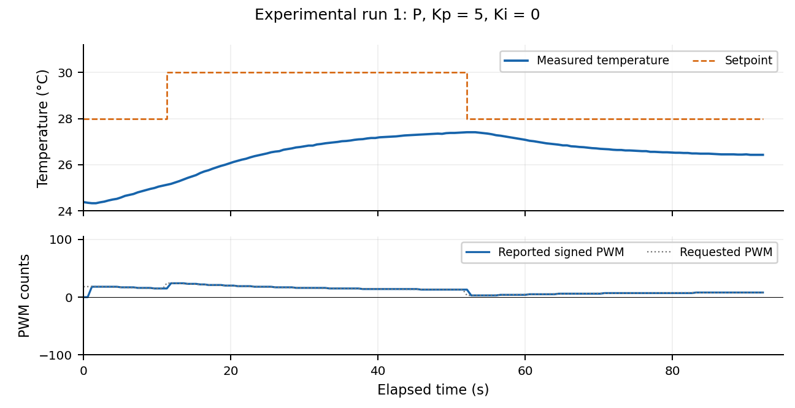

*Figure 1. Experimental P: Kp = 5 PWM/°C; Ki = 0 PWM/(°C·s). Initial T = 24.38 °C; 0/164 applied commands at ±255. Only actual applied PWM is shown; controller requests are not PWM output.*

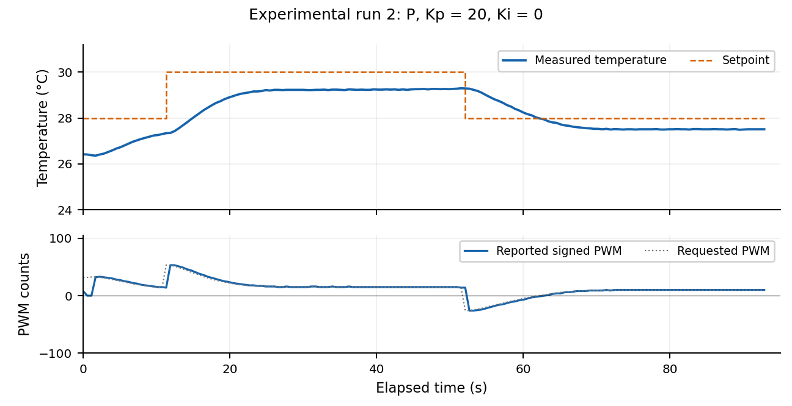

*Figure 2. Experimental P: Kp = 20 PWM/°C; Ki = 0 PWM/(°C·s). Initial T = 26.42 °C; 0/165 applied commands at ±255. Only actual applied PWM is shown; controller requests are not PWM output.*

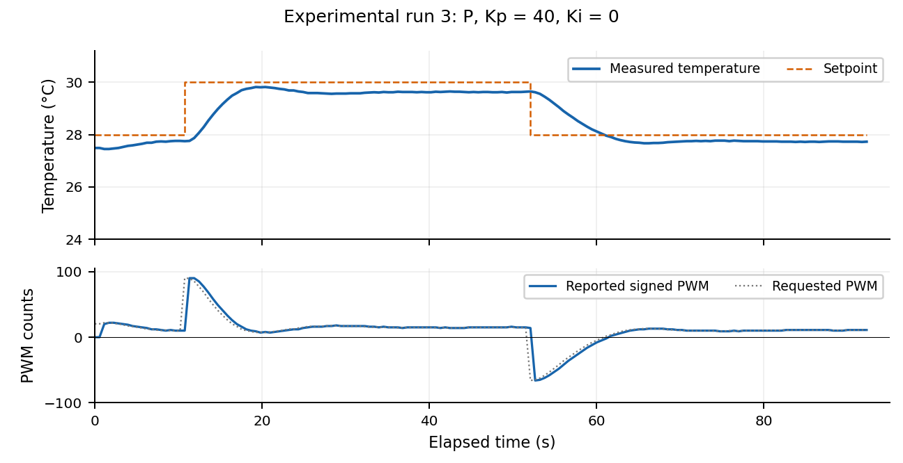

*Figure 3. Experimental P: Kp = 1000 PWM/°C; Ki = 0 PWM/(°C·s). Initial T = 24.77 °C; 133/163 applied commands at ±255. Only actual applied PWM is shown; controller requests are not PWM output.*

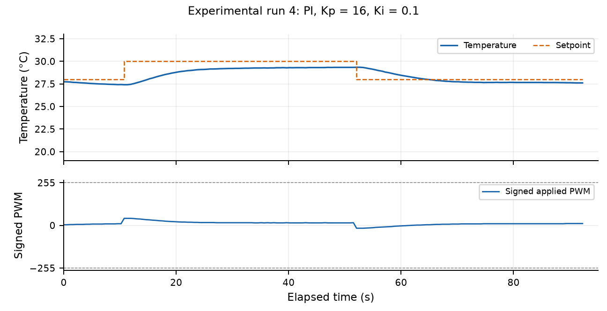

*Figure 4. Experimental PI: Kp = 16 PWM/°C; Ki = 0.1 PWM/(°C·s). Initial T = 27.74 °C; 0/164 applied commands at ±255. Only actual applied PWM is shown; controller requests are not PWM output.*

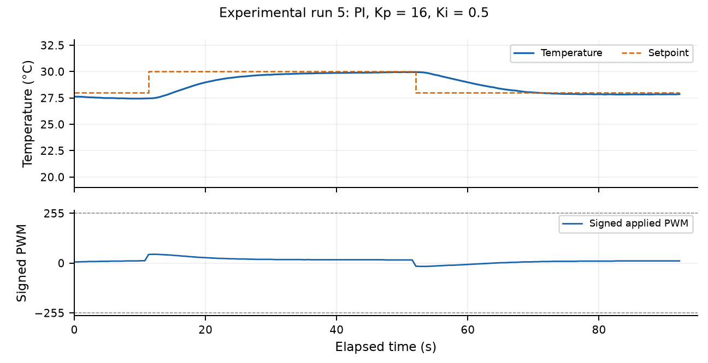

*Figure 5. Experimental PI: Kp = 16 PWM/°C; Ki = 0.5 PWM/(°C·s). Initial T = 27.62 °C; 0/163 applied commands at ±255. Only actual applied PWM is shown; controller requests are not PWM output.*

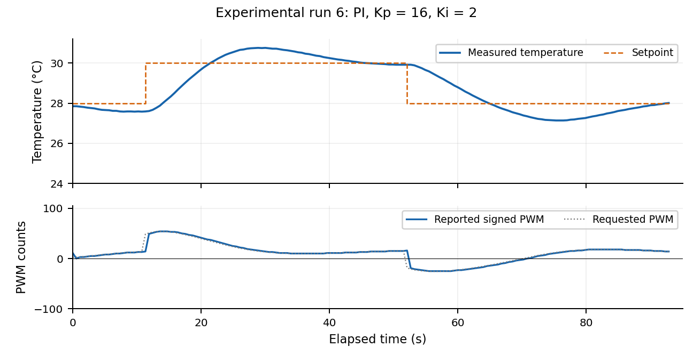

*Figure 6. Experimental PI: Kp = 1000 PWM/°C; Ki = 2 PWM/(°C·s). Initial T = 20.37 °C; 132/164 applied commands at ±255. Only actual applied PWM is shown; controller requests are not PWM output.*

### Largest-gain P and PI: both step directions

Rise time is the first 10%–90% crossing from the last pre-step measured temperature toward the new target, interpolated between samples. Overshoot is excursion beyond the target divided by the commanded 2 °C step. Settling requires remaining within ±0.04 °C through the end of the step, with at least 10 s observed in-band.

| Mode Kp/Ki | Step | Rise (s) | Overshoot (%) | Period (s) | End error (°C) |
| --- | --- | --- | --- | --- | --- |
| P 1000/0 | Up | 1.79 | 71.5 | 5.67 | -0.240 |
| P 1000/0 | Down | 2.82 | 35.0 | 6.23 | -0.247 |
| PI 1000/2 | Up | 0.54 | 66.0 | 5.66 | -0.317 |
| PI 1000/2 | Down | 2.03 | 36.5 | 5.67 | -0.221 |

For all four high-gain steps, settling time and steady-state error are **not established**. End error is target minus the final 5 s mean, not steady-state error. The 0.54 s PI upward rise spans approximately one sample interval and is poorly resolved. Period is the median peak-to-peak spacing, requiring at least three peaks confirmed by reversals ≥0.20 °C; sampling limits timing resolution to roughly 0.57 s.

Both high-gain recordings have recurring, bounded oscillations over the observed window. This is consistent with a nonlinear limit cycle, but does not prove ideal marginal stability or long-term boundedness. P run 3 reaches 31.43 °C / 27.30 °C on the up/down steps; PI run 6 reaches 31.32 °C / 27.27 °C. Applied PWM saturates on 133/163 and 132/164 samples, respectively.

## 3. Two-lump simulation and experiment comparison

One shared physical parameter set for all six simulations: χc = 0.1878 and χh = 0.5311 °C/PWM; τ = 91.69 s; Tamb = 24.220 °C; C = 100.549 J/K; H = 1.0966 W/K; Pu,c = 0.20595 W/PWM; r = 2.8280; G = 2 W/K; CT/C = 0.35; TEC voltage 12 V (assumed ON-state value), resistance 1.50 Ω; both masses initially 28 °C; targets 28 → 30 → 28 °C at 11 and 52 s; PWM ±255; q(0) = 0; anti-windup on; Δt = 0.01 s.

G and CT/C are unresolved internal estimates, retained at the assignment starting values. The high-P model reproduces overshoot and decay qualitatively, but cannot reproduce the measured persistent wave train. Exact fitting is not claimed. All simulations keep the same initial state as required; their 28 °C start differs from the recorded starts, and the common switching times differ slightly from individual host-timed experiments.

$$
C_T\dot T=P_u u-G(T-T_m),\qquad C_m\dot T_m=G(T-T_m)-H(T_m-T_{amb})
$$

The controller measures Tm. With perturbations θT and θm about equilibrium and unsaturated P feedback, GθT = Cm dθm/dt + (G + H)θm. Differentiate this expression and substitute the TEC balance to eliminate θT:

$$
C_TC_m\ddot\theta_m+S\dot\theta_m+G(H+P_uK_p)\theta_m=0,\quad S=C_T(G+H)+C_mG
$$

$$
\zeta_{2L,P}=\frac{S}{2\sqrt{C_TC_mG(H+P_uK_p)}},\quad K_{p,crit}=\frac{S^2/(4C_TC_mG)-H}{P_u}
$$

For this shared plant, heating-direction Kp,crit = **3.478 PWM/°C**. The three gains 5, 20, and 1000 are all above it, with progressively smaller damping. This shared model therefore does not reproduce a monotonic low-gain-to-critical-to-underdamped progression for these selected experimental gains.

$$
C_TC_m s^3+S s^2+G(H+P_uK_p)s+GP_uK_i=0
$$

For positive coefficients, Routh–Hurwitz requires S·G(H + PuKp) > CT·Cm·G·Pu·Ki. This yields:

$$
K_{i,crit}=\frac{S(H+P_uK_p)}{C_TC_mP_u},\qquad\rho_I=K_i/K_{i,crit}
$$

The unsaturated local PI model is stable for 0 < ρI < 1, marginal at ρI = 1, and unstable for ρI > 1. These heating-equilibrium classifications do not describe actuator clipping or the complete heating/cooling switching transient.

### Six simulations using the same plant and protocol

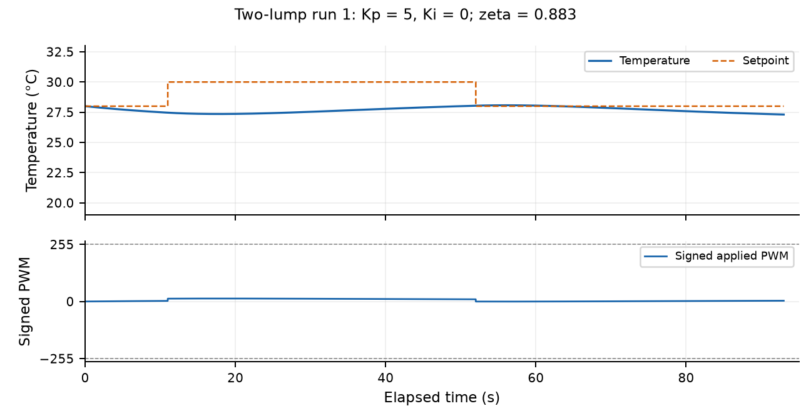

*Figure 7. Two-lump P: Kp = 5, Ki = 0; ζ₂L,P = 0.883. Local classification: stable underdamped. Applied PWM is clipped at ±255; nonlinear portions are not classified by the linear criterion alone.*

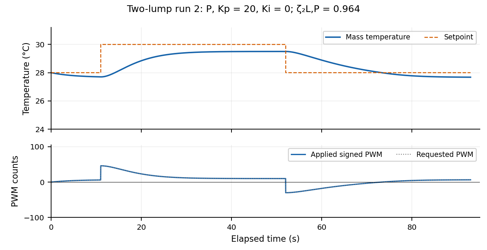

*Figure 8. Two-lump P: Kp = 20, Ki = 0; ζ₂L,P = 0.495. Local classification: stable underdamped. Applied PWM is clipped at ±255; nonlinear portions are not classified by the linear criterion alone.*

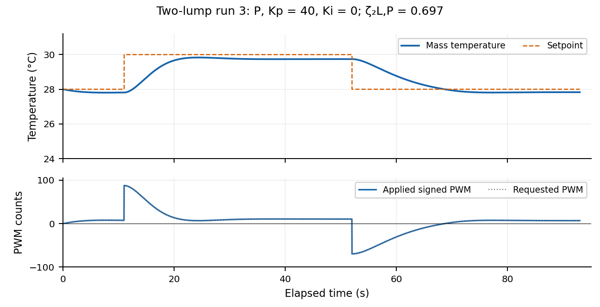

*Figure 9. Two-lump P: Kp = 1000, Ki = 0; ζ₂L,P = 0.073. Local classification: stable underdamped. Applied PWM is clipped at ±255; nonlinear portions are not classified by the linear criterion alone.*

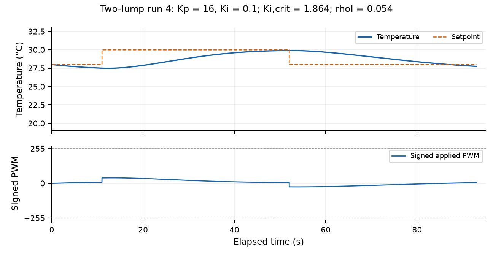

*Figure 10. Two-lump PI: Kp = 16, Ki = 0.1; Ki,crit = 1.864; ρI = 0.054. Local classification: stable underdamped. Applied PWM is clipped at ±255; nonlinear portions are not classified by the linear criterion alone.*

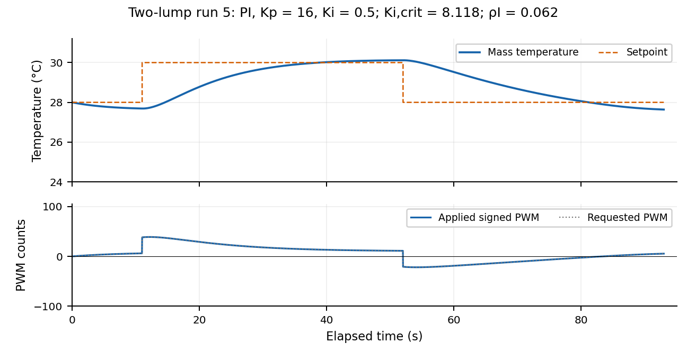

*Figure 11. Two-lump PI: Kp = 16, Ki = 0.5; Ki,crit = 1.864; ρI = 0.268. Local classification: stable underdamped. Applied PWM is clipped at ±255; nonlinear portions are not classified by the linear criterion alone.*

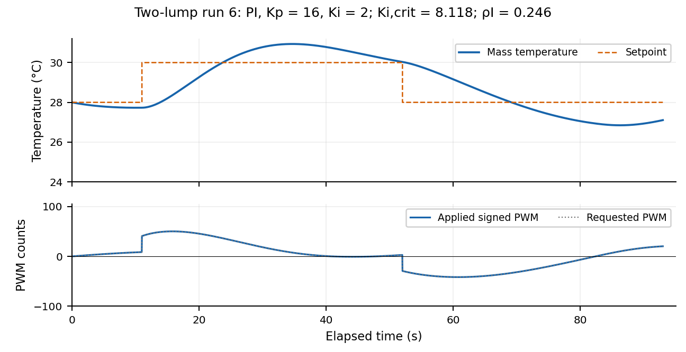

*Figure 12. Two-lump PI: Kp = 1000, Ki = 2; Ki,crit = 104.407; ρI = 0.019. Local classification: stable underdamped. Applied PWM is clipped at ±255; nonlinear portions are not classified by the linear criterion alone.*

### Guided comparison answers

| Run | Kp/Ki | Stability measure | Local model class |
| --- | --- | --- | --- |
| 1 | 5/0 | 0.883 | stable underdamped |
| 2 | 20/0 | 0.495 | stable underdamped |
| 3 | 1000/0 | 0.073 | stable underdamped |
| 4 | 16/0.1 | ρI = 0.054 | stable underdamped |
| 5 | 16/0.5 | ρI = 0.268 | stable underdamped |
| 6 | 1000/2 | ρI = 0.019 | stable underdamped |

**1. Best correspondence:** low/intermediate P simulations reproduce slow approach and remaining droop qualitatively; intermediate PI (Run 5) reproduces reduced target error. None reproduces the complete high-gain speed, persistent oscillation, and settling behavior. Initial conditions prevent a fair numerical ranking by rise time alone.

**2. P organization:** ζ decreases from 0.883 to 0.495 to 0.073; all gains exceed Kp,crit. Linear P poles remain negative, so ringing decays. The simulation can clip at high gain, requiring the nonlinear time trace as well as the pole calculation.

**3. PI organization:** Runs 4–5 share Kp = 16 and increase ρI from 0.054 to 0.268, making integral correction more aggressive. Run 6 changes Kp to 1000, raising Ki,crit to 104.407 and reducing ρI to 0.019 despite its higher Ki. The retained sequence is not an increasing-ρI study. All three local linear models are stable underdamped; none is marginal or unstable.

| High-gain case | Measured rise (s) | Model rise (s) | Measured OS (%) | Model OS (%) |
| --- | --- | --- | --- | --- |
| P Up | 1.79 | 4.04 | 71.5 | 87.8 |
| P Down | 2.82 | 6.22 | 35.0 | 21.0 |
| PI Up | 0.54 | 4.04 | 66.0 | 87.8 |
| PI Down | 2.03 | 6.22 | 36.5 | 21.0 |

**4. Agreement and disagreement:** both model and experiment show overshoot and PWM clipping at high gain. The measured high-gain period is about 5.7–6.2 s, whereas the shared model has slower, decaying oscillations. Persistent measured ringing contradicts the ideal unsaturated, continuous-time prediction of decay if that model is used to explain the full experiment. It does not prove the apparatus is linearly marginal: saturation, sampled control, additional thermal states, and changing parameters are omitted effects.

The high-gain simulations are model tests rather than fitted predictions. Halving Δt to 0.005 s changes temperature by at most 0.0201 °C across the six runs, much smaller than their main experimental discrepancies.

**Controlled parameter checks:** one-lump PI comparisons show higher Ki and C lower damping, while higher Kp raises it. The assigned two-lump P cases give ζ ≈1.31, 1.00, 0.81 at Kp = 60, 105, 160. At Kp = 105, G = 35, 50, 70 W/K gives ζ ≈0.84, 1.00, 1.18. An approximately equal capacitance split gives the weakest damping among the tested splits. These practice figures remain in Part_II/RESULTS.md, separate from the twelve Goldilocks figures.

## 4. PI steady state, assumptions, and windup

$$
u=K_pe+K_iq,\quad\dot q=e,\quad e=T_{set}-T
$$

At a stable, unsaturated PI equilibrium, q is constant, so dq/dt = e = 0. Therefore **Tss = Tset = 55 °C**. The P term becomes zero, while the stored I term supplies the heat-loss-balancing command:

$$
u_{ss}=u_I=\frac{H(55-T_{amb})}{P_{u,h}}=\frac{55-24.220}{0.5311}=57.95\ \mathrm{PWM}
$$

This is an ideal calculation, not a 55 °C hardware run. It requires stable feedback, enough heating power within ±255, no active shutdown, continued integral action with Ki > 0, and accurate, timely measurement. Sensor bias would make indicated rather than actual temperature equal 55 °C.

**Windup:** while applied PWM is capped, persistent error can keep increasing q. The excessive stored command then continues heating after the target is crossed, causing overshoot and delayed recovery. Conditional anti-windup holds q when the proposed integral update pushes the request farther past the limit, and permits updates that bring it back. The clamp and shutdown remain separate protections.

**Reset thought experiment:** at equilibrium P = 0 and I provides the balancing heat. Clearing q removes that command; temperature initially falls, then P responds and I rebuilds. Integral reset does not preserve the former equilibrium output.

## 5. Model limits and final gain choice

$$
T(t)-T_{ss}=[T(0)-T_{ss}]\exp[-(1+\chi K_p)t/\tau]
$$

In the ideal continuous-time one-lump P model, the exponential is positive and decays: temperature approaches its equilibrium monotonically and cannot ring. This statement assumes instantaneous feedback; it is not a claim that every physical P controller is non-oscillatory. The observed Kp = 1000 P oscillation is direct evidence that this simplest model is inadequate.

The two-lump balances add a second stored-energy state. Heat first changes the TEC-side temperature, then passes through G to the measured mass. Tm can continue rising after the command falls because the TEC-side mass remains hotter. This lag permits P overshoot and ringing; the twelve figures show what the model captures and where it fails.

**Selected P:** Kp = 20 PWM/°C is a provisional measured compromise: it reduces the large error of Kp = 5 and avoids the large oscillations and saturation of Kp = 1000. The selected shared model gives ζ = 0.495 and Kp,crit = 3.478, predicting an underdamped response rather than critical damping. Selection is based on the measured tradeoff, not a claim that this gain is theoretically optimal.

**Selected PI:** Kp = 16 PWM/°C and Ki = 0.5 PWM/(°C·s), with ρI = 0.268, combines relatively small final target error with limited overshoot in Run 5. Ki = 0.1 corrects more slowly; Kp = 1000, Ki = 2 produces persistent large excursions and clipping. Since the high-PI rerun changes both gains, it cannot establish the isolated effect of Ki. Neither selected gain pair has a verified long-term settling result.

**Next physical effect:** include the actual ≈0.57 s sampled controller and measurement/command delay. The present continuous-feedback simulation updates much faster. Further thermal states, sensor placement, and temperature-dependent TEC coefficients may also matter; these data do not identify a unique cause of the persistent oscillation.

## Data, code, and reproduction

Build command from the repository root (phys39a environment):
/opt/anaconda3/envs/phys39a/bin/python code/module6/A3/build_a3.py --save-csv

[Analysis and report builder](../../code/module6/A3/build_a3.py) · [Experimental metrics](../../code/module6/A3/results/experimental_metrics.csv) · [Shared settings and stability calculations](../../code/module6/A3/results/analysis.json) · [Controlled comparison results](../../code/module6/Part_II/RESULTS.md)

[Experimental Run 1 raw recording](../../code/module6/Part_I/P7_experimental_goldilocks/data/screening_run1_20261014_105029_872226.csv) · [Simulation Run 1 data](../../code/module6/A3/results/simulation_1.csv)

[Experimental Run 2 raw recording](../../code/module6/Part_I/P7_experimental_goldilocks/data/screening_run2_20261014_105202_883449.csv) · [Simulation Run 2 data](../../code/module6/A3/results/simulation_2.csv)

[Experimental Run 3 raw recording](../../code/module6/Part_I/P7_experimental_goldilocks/data/screening_run3_20261019_093931_013605.csv) · [Simulation Run 3 data](../../code/module6/A3/results/simulation_3.csv)

[Experimental Run 4 raw recording](../../code/module6/Part_I/P7_experimental_goldilocks/data/screening_run4_20261014_105508_891380.csv) · [Simulation Run 4 data](../../code/module6/A3/results/simulation_4.csv)

[Experimental Run 5 raw recording](../../code/module6/Part_I/P7_experimental_goldilocks/data/screening_run5_20261014_105641_882344.csv) · [Simulation Run 5 data](../../code/module6/A3/results/simulation_5.csv)

[Experimental Run 6 raw recording](../../code/module6/Part_I/P7_experimental_goldilocks/data/screening_run6_20261019_094847_056154.csv) · [Simulation Run 6 data](../../code/module6/A3/results/simulation_6.csv)

GitHub modeling/data checkpoint: [ff2f524 — Part 7 data with saturation reruns](https://github.com/hasanm720/Module1/commit/ff2f524b009e5d64936f1dcef9125ed07551ceb1). This report is a later local build; the checkpoint is not claimed to include the finished PDF.

Assignment: [A3 Questions 1–5](https://sethfraden.github.io/Phys39F26-course/labs/lab-06/#a3-questions). Simulation protocol: [Module 6 Part II](https://sethfraden.github.io/Phys39F26-course/labs/lab-07/).

